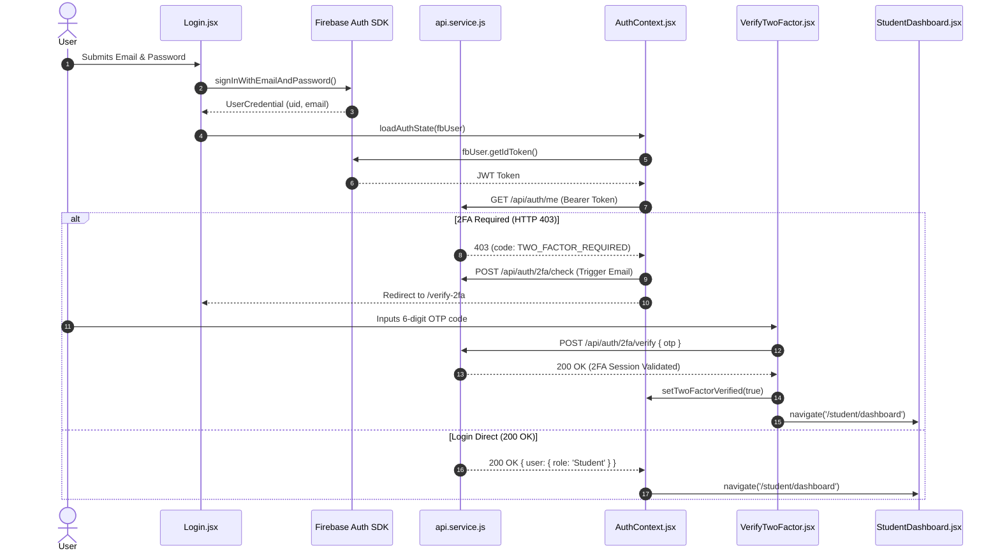
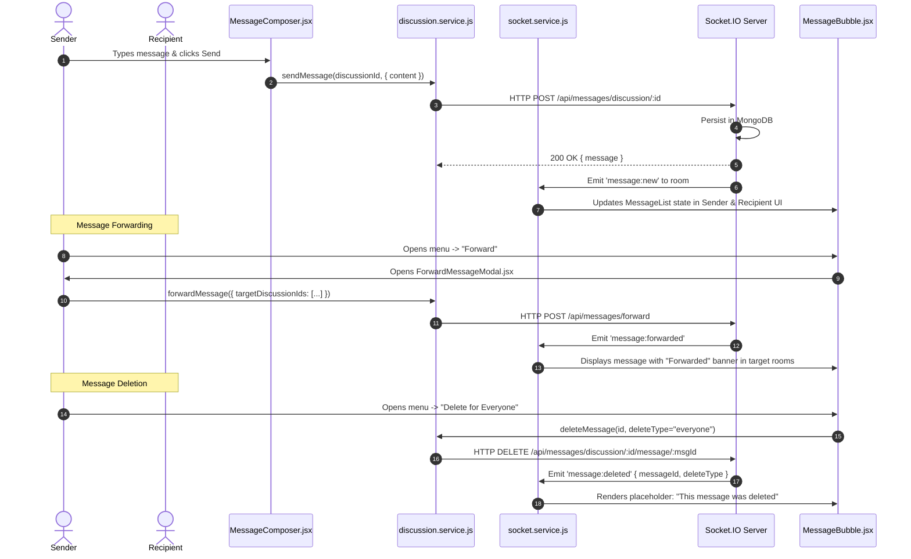
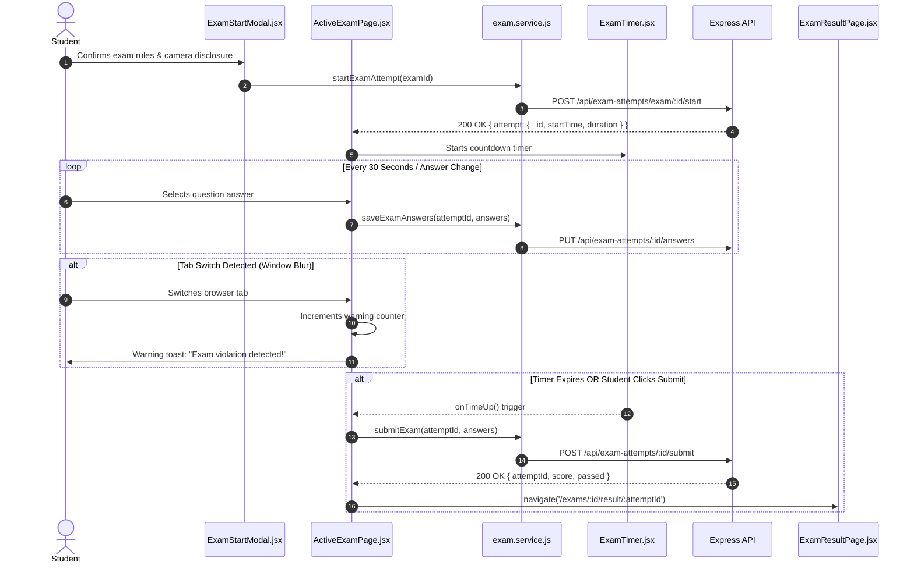

# SHNOOR LMS — Frontend Data Flow, Services & API Integrations

> **Document Version:** 1.0.0  
> **Target Audience:** Frontend Engineers, Full-Stack Developers, Integration Specialists  
> **Status:** Production-Grade Documentation  
> **Source Directory:** [`src/services/`](../src/services/)  
> **Last Updated:** October 2026  

---

## 📑 Table of Contents

1. [Architectural Overview of Frontend Data Flow](#1-architectural-overview-of-frontend-data-flow)
2. [API Client Architecture & Request Interceptors](#2-api-client-architecture--request-interceptors)
3. [Token Exchange, Session Management & Refresh Strategy](#3-token-exchange-session-management--refresh-strategy)
4. [Master API Integration Directory (Every Discovered Endpoint)](#4-master-api-integration-directory-every-discovered-endpoint)
5. [Real-Time WebSocket Architecture (Socket.IO)](#5-real-time-websocket-architecture-socketio)
6. [Local, Ambient & Persistent State Management](#6-local-ambient--persistent-state-management)
7. [Data Transformation, Normalization & Caching Layer](#7-data-transformation-normalization--caching-layer)
8. [File Upload & Client-Side Download Engine](#8-file-upload--client-side-download-engine)
9. [Error Propagation, Toast Feedback & Retries](#9-error-propagation-toast-feedback--retries)
10. [Client-Side Security & Data Protection](#10-client-side-security--data-protection)
11. [External Third-Party Service Dependencies](#11-external-third-party-service-dependencies)
12. [End-to-End Workflow Sequence Diagrams](#12-end-to-end-workflow-sequence-diagrams)
13. [Integration Vulnerabilities & Potential Failure Points](#13-integration-vulnerabilities--potential-failure-points)

---

## 1. Architectural Overview of Frontend Data Flow

SHNOOR LMS strictly adheres to a **predictable, unidirectional data flow** model:

```
[ User Interaction ] 
        │
        ▼
[ React Component / Page ]
        │ (Invokes Callback Handler)
        ▼
[ Custom Hook / Context / Service Method ]
        │ (Dispatches HTTP Request or WebSocket Event)
        ▼
[ api.service.js (Axios) / socket.service.js (Socket.IO) ]
        │ (Appends Firebase Bearer Token / Handles Transport)
        ▼
[ Backend REST API / Socket.IO Server (Render) ]
        │ (Executes Business Logic / MongoDB Query)
        ▼
[ Response Payload Received ]
        │ (Error Interceptor / JSON Parsing)
        ▼
[ React State Update (Context / useState) ]
        │ (Re-renders Dependent Virtual DOM Subtree)
        ▼
[ UI Update (DOM Rendering, Toast Feedback, Animated Elements) ]
```

---

## 2. API Client Architecture & Request Interceptors

The primary HTTP transport is managed by [`src/services/api.service.js`](../src/services/api.service.js) using **Axios**:

### 2.1. Base Configuration
```javascript
const API_BASE_URL = (
  import.meta.env.VITE_API_BASE_URL ||
  import.meta.env.VITE_API_URL ||
  ""
).replace(/\/$/, "");

const api = axios.create({
  baseURL: API_BASE_URL,
  withCredentials: true,
  headers: {
    "Content-Type": "application/json",
  },
});
```

### 2.2. Request Interceptor (Automated Bearer Injection)
Before every outgoing HTTP request, the interceptor checks for an authenticated Firebase user:
1. Verifies if an `Authorization` header has already been explicitly supplied.
2. If omitted, queries `auth.currentUser`.
3. If an authenticated user exists, calls `currentUser.getIdToken()`, obtaining a fresh or cached Firebase JWT.
4. Appends `Authorization: Bearer <token>` to request headers.

### 2.3. Response Interceptor (Normalized Error Translation)
The response interceptor catches rejected promises and transforms them into standardized `Error` objects:
- Extracts `error.response.data.message`.
- If the network request failed to reach the server, returns `"Unable to reach the server. Please check your connection."`.
- Preserves `error.response.status` and `error.response` on the custom error object, allowing downstream catch blocks to distinguish between HTTP 401, 403, 404, and 500.

---

## 3. Token Exchange, Session Management & Refresh Strategy

1. **Credentials Ingestion**: Users authenticate using Firebase Authentication SDK (`signInWithEmailAndPassword`, `signInWithPopup(googleProvider)`).
2. **Session Persistence**: Firebase stores the credential tokens internally within browser IndexedDB/localStorage.
3. **Identity Sync**: `AuthContext` detects `onAuthStateChanged`, extracts the JWT ID token, and executes `GET /api/auth/me`.
4. **Token Refresh Lifecycle**:
   - Firebase JWT ID tokens expire after 1 hour.
   - The Firebase SDK automatically refreshes the token in the background.
   - When `api.interceptors.request` calls `getIdToken()`, Firebase automatically returns a valid token, ensuring requests never fail due to token expiry during an active session.
   - For WebSockets, [`socket.service.js`](../src/services/socket.service.js) binds to `reconnect_attempt` and `connect_error` events, calling `getIdToken(true)` to refresh expired socket credentials before retrying.

---

## 4. Master API Integration Directory (Every Discovered Endpoint)

The following reference details **every verified API endpoint** implemented across the frontend service modules:

### 4.1. Authentication & Security Endpoints (`src/context/AuthContext.jsx`, `src/services/api.service.js`)

| HTTP Method | API Endpoint | Purpose | Request Payload | Response Data | Consuming Module |
| :--- | :--- | :--- | :--- | :--- | :--- |
| `GET` | `/api/auth/me` | Fetches active user profile & verifies MongoDB role | None (Bearer Token) | `{ user: { _id, email, role, name, ... } }` | `AuthContext.jsx` |
| `POST` | `/api/auth/register-profile` | Completes user profile after social signup | `{ role, name, studentId, ... }` | `{ success: true, user }` | `Signup.jsx` |
| `POST` | `/api/auth/logout` | Clears backend session cookies | None | `{ message: "Logged out" }` | `AuthContext.jsx` |
| `POST` | `/api/auth/2fa/check` | Initiates 2FA flow and sends OTP code | None | `{ message: "OTP sent" }` | `AuthContext.jsx`, `VerifyTwoFactor.jsx` |
| `POST` | `/api/auth/2fa/verify` | Verifies 6-digit OTP code | `{ otp: "123456" }` | `{ success: true, token }` | `VerifyTwoFactor.jsx` |
| `PATCH` | `/api/auth/2fa/toggle` | Enables or disables 2FA for the account | `{ enabled: Boolean }` | `{ twoFactorEnabled: Boolean }` | `TwoFactorToggle.jsx` |

---

### 4.2. Courses & Category Taxonomy (`src/pages/CourseList.jsx`, `src/pages/CourseDetails.jsx`)

| HTTP Method | API Endpoint | Purpose | Request Payload | Response Data | Consuming Module |
| :--- | :--- | :--- | :--- | :--- | :--- |
| `GET` | `/api/courses` | Lists all published courses | None | `{ courses: [...] }` | `CourseList.jsx`, `LandingPage.jsx` |
| `GET` | `/api/courses/:id` | Fetches course details, syllabus & reviews | None | `{ course: { ... } }` | `CourseDetails.jsx`, `CourseLearn.jsx` |
| `GET` | `/api/categories` | Lists all course categories | None | `{ categories: [...] }` | `CourseList.jsx`, `CategoryManagement.jsx` |
| `GET` | `/api/courses/enrolled/my` | Retrieves courses enrolled by active student | None | `{ courses: [...] }` | `CourseList.jsx`, `StudentMyCourses.jsx` |
| `POST` | `/api/courses/:id/enroll` | Enrolls student into a free/purchased course | `{ paymentDetails? }` | `{ success: true, enrollment }` | `CourseDetails.jsx` |

---

### 4.3. Student Portal Endpoints (`src/services/student.service.js`)

| HTTP Method | API Endpoint | Purpose | Request Payload | Response Data | Consuming Module |
| :--- | :--- | :--- | :--- | :--- | :--- |
| `GET` | `/api/student/profile` | Fetches student profile information | None | `{ profile: { ... } }` | `ProfileSettings.jsx` |
| `PUT` | `/api/student/profile` | Updates student biography and phone | `{ name, bio, phone }` | `{ updatedProfile }` | `ProfileSettings.jsx` |
| `POST` | `/api/student/profile/image` | Uploads student avatar image | `FormData(file)` | `{ imageUrl: "https://..." }` | `ProfileSettings.jsx` |
| `DELETE` | `/api/student/profile` | Deletes student account | None | `{ message: "Deleted" }` | `ProfileSettings.jsx` |
| `GET` | `/api/certificates/my` | Fetches all certificates earned by student | None | `{ certificates: [...] }` | `StudentCertificates.jsx` |

---

### 4.4. Instructor Curriculum Endpoints (`src/services/instructor.service.js`)

| HTTP Method | API Endpoint | Purpose | Request Payload | Response Data | Consuming Module |
| :--- | :--- | :--- | :--- | :--- | :--- |
| `GET` | `/api/instructor/profile` | Fetches instructor credentials & bio | None | `{ instructor: { ... } }` | `ProfileSettings.jsx` |
| `PUT` | `/api/instructor/profile` | Updates instructor metadata | `{ name, bio, expertise }` | `{ updatedProfile }` | `ProfileSettings.jsx` |
| `POST` | `/api/instructor/profile/image`| Uploads instructor profile avatar | `FormData(file)` | `{ imageUrl: "https://..." }` | `ProfileSettings.jsx` |
| `GET` | `/api/courses/instructor/my` | Retrieves courses authored by current user | None | `{ courses: [...] }` | `MyCourses.jsx` |
| `POST` | `/api/courses` | Creates new course draft | `{ title, category, price }` | `{ courseId, course }` | `CreateCourse.jsx` |
| `PUT` | `/api/courses/:id` | Updates course metadata | `{ title, description, ... }` | `{ course }` | `EditCourse.jsx` |
| `PATCH` | `/api/courses/:id/publish` | Toggles course published status | None | `{ status: "published" }` | `MyCourses.jsx` |
| `DELETE` | `/api/courses/:id` | Permanently deletes course | None | `{ message: "Deleted" }` | `MyCourses.jsx` |
| `POST` | `/api/courses/:id/modules` | Appends chapter or lesson module | `FormData(video, title)` | `{ module: { ... } }` | `CourseContent.jsx` |

---

### 4.5. Assignment Suite Endpoints (`src/services/assignment.service.js`)

| HTTP Method | API Endpoint | Purpose | Request Payload | Response Data | Consuming Module |
| :--- | :--- | :--- | :--- | :--- | :--- |
| `GET` | `/api/assignment/course/:courseId` | Fetches assignments for a course | None | `{ assignments: [...] }` | `InstructorAssignments.jsx` |
| `GET` | `/api/assignment/:id` | Retrieves single assignment specifications | None | `{ assignment: { ... } }` | `AssignmentDetailModal.jsx` |
| `POST` | `/api/assignment/course/:courseId`| Creates assignment with reference files | `FormData(title, due, file)` | `{ assignment }` | `AssignmentModal.jsx` |
| `PUT` | `/api/assignment/:id` | Updates assignment parameters | `FormData(...)` | `{ assignment }` | `AssignmentModal.jsx` |
| `PATCH` | `/api/assignment/:id/publish` | Publishes assignment to enrolled students | None | `{ status: "published" }` | `InstructorAssignments.jsx` |
| `DELETE` | `/api/assignment/:id` | Deletes assignment | None | `{ success: true }` | `InstructorAssignments.jsx` |
| `POST` | `/api/assignment/:id/submit` | Student uploads homework submission | `FormData(file, notes)` | `{ submission }` | `AssignmentDetailModal.jsx` |
| `GET` | `/api/assignment/:id/my-submission`| Student views their own submission | None | `{ submission: { ... } }` | `AssignmentDetailModal.jsx` |
| `GET` | `/api/assignment/:id/submissions` | Instructor lists all student submissions | None | `{ submissions: [...] }` | `AssignmentSubmissionsModal.jsx`|
| `PATCH` | `/api/assignment/submissions/:id/evaluate` | Instructor grades and leaves feedback | `{ marks: 95, feedback: "..." }` | `{ submission }` | `AssignmentSubmissionsModal.jsx`|

---

### 4.6. Quiz Suite Endpoints (`src/services/quiz.service.js`)

| HTTP Method | API Endpoint | Purpose | Request Payload | Response Data | Consuming Module |
| :--- | :--- | :--- | :--- | :--- | :--- |
| `GET` | `/api/quizzes/course/:courseId` | Retrieves quizzes created for a course | None | `{ quizzes: [...] }` | `InstructorQuizzes.jsx` |
| `GET` | `/api/quizzes/student/my-quizzes` | Retrieves all quizzes for enrolled student | None | `{ quizzes: [...] }` | `StudentQuizzes.jsx` |
| `GET` | `/api/quizzes/:id` | Fetches quiz details and rules | None | `{ quiz: { ... } }` | `QuizTest.jsx` |
| `POST` | `/api/quizzes/course/:courseId` | Creates new quiz entity | `{ title, timeLimit, passMark }`| `{ quiz }` | `QuizBuilderModal.jsx` |
| `PATCH` | `/api/quizzes/:id/publish` | Publishes quiz | None | `{ status: "published" }` | `InstructorQuizzes.jsx` |
| `DELETE` | `/api/quizzes/:id` | Deletes quiz | None | `{ success: true }` | `InstructorQuizzes.jsx` |
| `POST` | `/api/quizzes/:id/ai-generate-questions` | AI automated question generation | `FormData(topic, count, level)`| `{ questions: [...] }` | `QuizBuilderModal.jsx` |
| `POST` | `/api/quiz-questions/quiz/:id` | Adds manual multiple-choice question | `{ question, options, answer }` | `{ question }` | `QuizBuilderModal.jsx` |
| `POST` | `/api/quizzes/:id/evaluate` | Evaluates submitted answers & returns score | `{ answers: { [qId]: option } }`| `{ score, passed, summary }` | `QuizTest.jsx` |

---

### 4.7. Examination & Anti-Cheat Suite (`src/services/exam.service.js`)

| HTTP Method | API Endpoint | Purpose | Request Payload | Response Data | Consuming Module |
| :--- | :--- | :--- | :--- | :--- | :--- |
| `GET` | `/api/exams/course/:courseId` | Fetches course examinations | None | `{ exams: [...] }` | `InstructorExams.jsx` |
| `GET` | `/api/exams/student/my-exams` | Fetches all available exams for student | None | `{ exams: [...] }` | `StudentExams.jsx` |
| `GET` | `/api/exams/:id` | Fetches exam details, duration & rules | None | `{ exam: { ... } }` | `ExamDetailsPage.jsx` |
| `POST` | `/api/exams/course/:courseId` | Instructor creates proctored exam | `{ title, duration, totalMarks }`| `{ exam }` | `ExamBuilderModal.jsx` |
| `PATCH` | `/api/exams/:id/publish` | Publishes exam | None | `{ status: "published" }` | `InstructorExams.jsx` |
| `DELETE` | `/api/exams/:id` | Deletes exam | None | `{ success: true }` | `InstructorExams.jsx` |
| `POST` | `/api/exams/:id/ai-generate-questions` | Generates exam questions using AI | `FormData(topic, count)` | `{ questions: [...] }` | `AIGenerateQuestionsModal.jsx` |
| `GET` | `/api/exam-questions/exam/:id` | Fetches all questions for an exam | None | `{ questions: [...] }` | `InstructorExamQuestions.jsx` |
| `POST` | `/api/exam-attempts/exam/:id/start` | Initiates timed exam attempt | None | `{ attempt: { _id, startTime } }`| `ActiveExamPage.jsx` |
| `GET` | `/api/exam-attempts/exam/:id/active`| Resumes existing in-progress attempt | None | `{ attempt: { answers, ... } }` | `ActiveExamPage.jsx` |
| `PUT` | `/api/exam-attempts/:id/answers` | Persists incremental answer updates | `{ answers: [...] }` | `{ success: true }` | `ActiveExamPage.jsx` |
| `POST` | `/api/exam-attempts/:id/submit` | Finalizes exam submission | `{ answers: [...] }` | `{ resultId, score }` | `ActiveExamPage.jsx` |
| `GET` | `/api/exam-attempts/:id/result` | Retrieves detailed score and review | None | `{ result: { ... } }` | `ExamResultPage.jsx` |
| `GET` | `/api/exam-attempts/exam/:id/leaderboard` | Fetches exam ranking leaderboard | None | `{ leaderboard: [...] }` | `ExamLeaderboardPage.jsx` |

---

### 4.8. Real-Time Discussions & Direct Chat (`src/services/discussion.service.js`, `src/services/directChat.service.js`)

| HTTP Method | API Endpoint | Purpose | Request Payload | Response Data | Consuming Module |
| :--- | :--- | :--- | :--- | :--- | :--- |
| `GET` | `/api/discussions/my` | Lists user's course discussion rooms | None | `{ discussions: [...] }` | `DiscussionSidebar.jsx` |
| `GET` | `/api/discussions/course/:courseId`| Fetches discussion room for specific course | None | `{ discussion: { ... } }` | `DiscussionPage.jsx` |
| `GET` | `/api/discussions/:id/members` | Lists active room members & presence | None | `{ members: [...] }` | `GroupMembersPanel.jsx` |
| `GET` | `/api/messages/discussion/:id` | Retrieves paginated message history | None | `{ messages: [...] }` | `MessageList.jsx` |
| `POST` | `/api/messages/discussion/:id` | Sends new discussion message | `{ content, type, fileUrl, ... }`| `{ message: { ... } }` | `MessageComposer.jsx` |
| `DELETE` | `/api/messages/discussion/:id/message/:msgId` | Deletes message (for me or everyone) | `?deleteType=me|everyone` | `{ success: true }` | `DeleteMessageDialog.jsx` |
| `POST` | `/api/messages/forward` | Forwards message across rooms & contacts | `{ sourceType, sourceMessageId, ... }` | `{ forwardedCount, results }` | `ForwardMessageModal.jsx` |
| `POST` | `/api/messages/discussion/:id/message/:msgId/react` | Toggles emoji reaction on message | `{ emoji: "👍" }` | `{ reactions: [...] }` | `MessageBubble.jsx` |
| `POST` | `/api/messages/discussion/:id/upload` | Uploads discussion media/file attachment | `FormData(file)` | `{ fileUrl, fileName, ... }` | `AttachmentMenu.jsx` |
| `DELETE` | `/api/messages/discussion/:id/clear` | Clears all messages in room (Admin) | None | `{ success: true }` | `ClearDiscussionDialog.jsx` |
| `POST` | `/api/direct-chat/get-or-create`| Initiates or returns existing 1-on-1 chat | `{ targetUserId }` | `{ conversation: { ... } }` | `DiscussionSidebar.jsx` |
| `GET` | `/api/direct-chat/my-conversations` | Lists user's 1-on-1 direct conversations | None | `{ conversations: [...] }` | `DiscussionSidebar.jsx` |
| `GET` | `/api/direct-chat/:id/messages` | Retrieves direct message history | None | `{ messages: [...] }` | `DirectChatRoom.jsx` |
| `POST` | `/api/direct-chat/:id/messages` | Sends direct message | `{ content, type, ... }` | `{ message: { ... } }` | `MessageComposer.jsx` |
| `DELETE` | `/api/direct-chat/:id/message/:msgId` | Deletes direct message | `?deleteType=me|everyone` | `{ success: true }` | `DeleteMessageDialog.jsx` |
| `POST` | `/api/direct-chat/:id/upload` | Uploads direct attachment | `FormData(file)` | `{ fileUrl, ... }` | `AttachmentMenu.jsx` |

---

### 4.9. Course Query (Q&A) Tickets (`src/services/courseQuery.service.js`)

| HTTP Method | API Endpoint | Purpose | Request Payload | Response Data | Consuming Module |
| :--- | :--- | :--- | :--- | :--- | :--- |
| `POST` | `/api/course-queries` | Submits student inquiry ticket | `{ courseId, title, message }` | `{ query: { ... } }` | `CreateQueryModal.jsx` |
| `GET` | `/api/course-queries/my-queries` | Student fetches their submitted queries | None | `{ queries: [...] }` | `StudentQueries.jsx` |
| `GET` | `/api/course-queries/course/:id` | Instructor fetches queries for their course | None | `{ queries: [...] }` | `InstructorQueries.jsx` |
| `GET` | `/api/course-queries/:id` | Fetches query details & conversation thread | None | `{ query: { ... } }` | `QueryConversation.jsx` |
| `POST` | `/api/course-queries/:id/replies` | Posts reply message to ticket thread | `{ message: "..." }` | `{ reply: { ... } }` | `QueryConversation.jsx` |
| `PATCH` | `/api/course-queries/:id/status` | Updates query status (open/resolved) | `{ status: "resolved" }` | `{ query }` | `QueryConversation.jsx` |
| `GET` | `/api/course-queries/admin/all` | Admin fetches all system-wide queries | None | `{ queries: [...] }` | `AdminQueries.jsx` |
| `GET` | `/api/course-queries/admin/stats`| Admin fetches query resolution stats | None | `{ stats: { ... } }` | `AdminQueries.jsx` |

---

### 4.10. Reviews & Ratings (`src/services/review.service.js`)

| HTTP Method | API Endpoint | Purpose | Request Payload | Response Data | Consuming Module |
| :--- | :--- | :--- | :--- | :--- | :--- |
| `GET` | `/api/reviews/course/:courseId` | Fetches paginated reviews for a course | `?page=1&limit=5` | `{ reviews: [...], total }` | `CourseReviews.jsx` |
| `GET` | `/api/reviews/course/:courseId/summary`| Fetches aggregate rating & distribution | None | `{ averageRating, distribution }`| `ReviewSummary.jsx` |
| `GET` | `/api/reviews/course/:courseId/mine` | Fetches current student's review | None | `{ review: { ... } }` | `ReviewForm.jsx` |
| `POST` | `/api/reviews/course/:courseId` | Submits new star rating and feedback | `{ rating: 5, comment: "..." }` | `{ review: { ... } }` | `ReviewForm.jsx` |
| `PUT` | `/api/reviews/:id` | Modifies existing review | `{ rating: 4, comment: "..." }` | `{ review: { ... } }` | `ReviewForm.jsx` |
| `DELETE` | `/api/reviews/:id` | Deletes review | None | `{ success: true }` | `ReviewCard.jsx` |

---

### 4.11. Grievance Reports (`src/services/report.service.js`)

| HTTP Method | API Endpoint | Purpose | Request Payload | Response Data | Consuming Module |
| :--- | :--- | :--- | :--- | :--- | :--- |
| `POST` | `/api/reports` | Submits problem ticket with screenshot | `FormData(subject, body, file)`| `{ report: { ... } }` | `MyReports.jsx` |
| `GET` | `/api/reports/my` | Fetches current user's submitted reports | None | `{ reports: [...] }` | `MyReports.jsx` |
| `GET` | `/api/reports/admin/all` | Admin fetches all reported issues | None | `{ reports: [...] }` | `AdminReports.jsx` |
| `PATCH` | `/api/reports/:id/status` | Admin updates ticket status | `{ status: "resolved" }` | `{ report }` | `AdminReports.jsx` |
| `PATCH` | `/api/reports/:id/reply` | Admin posts official reply to user | `{ reply: "..." }` | `{ report }` | `AdminReports.jsx` |

---

### 4.12. Analytics & Business Intelligence (`src/services/analytics.service.js`)

| HTTP Method | API Endpoint | Purpose | Request Payload | Response Data | Consuming Module |
| :--- | :--- | :--- | :--- | :--- | :--- |
| `GET` | `/api/analytics/student/dashboard` | Student learning hours & completion trends | `?range=30d` | `{ kpis, activityTrends, ... }` | `StudentDashboard.jsx` |
| `GET` | `/api/analytics/instructor/dashboard` | Instructor revenue & enrollment trends | `?range=30d` | `{ kpis, coursePerformance }` | `InstructorDashboard.jsx` |
| `GET` | `/api/analytics/course/:courseId` | Detailed analytics for a specific course | `?range=90d` | `{ completionRate, dropouts }` | `CourseAnalytics.jsx` |
| `GET` | `/api/analytics/student/:studentId`| In-depth performance view for single student| `?range=all` | `{ quizzesTaken, examScores }` | `StudentAnalytics.jsx` |

---

### 4.13. Notification Management (`src/context/NotificationContext.jsx`)

| HTTP Method | API Endpoint | Purpose | Request Payload | Response Data | Consuming Module |
| :--- | :--- | :--- | :--- | :--- | :--- |
| `GET` | `/api/notifications` | Fetches user's notification feed | `?page=1&limit=10` | `{ notifications: [...], hasMore }`| `NotificationContext.jsx`|
| `GET` | `/api/notifications/unread-count` | Fetches count of unread notifications | None | `{ count: 3 }` | `NotificationContext.jsx`|
| `PATCH` | `/api/notifications/:id/read` | Marks single notification as read | None | `{ success: true }` | `NotificationDropdown.jsx`|
| `PATCH` | `/api/notifications/read-all` | Marks entire feed as read | None | `{ success: true }` | `NotificationDropdown.jsx`|

---

### 4.14. Conversational AI Chatbot (`src/services/chatbot.service.js`)

| HTTP Method | API Endpoint | Purpose | Request Payload | Response Data | Consuming Module |
| :--- | :--- | :--- | :--- | :--- | :--- |
| `POST` | `/api/chatbot/chat` | Sends message to AI assistant | `{ message: "...", history: [...] }`| `{ reply: "...", timestamp }` | `FloatingChatbot.jsx` |
| `GET` | `/api/chatbot/logs` | Admin inspects chatbot conversation logs | `?page=1&limit=20` | `{ logs: [...], total }` | `AdminChatbotLogs.jsx` |
| `DELETE` | `/api/chatbot/logs/:id` | Admin deletes specific conversation log | None | `{ success: true }` | `AdminChatbotLogs.jsx` |
| `DELETE` | `/api/chatbot/logs` | Admin clears entire conversation log | None | `{ success: true }` | `AdminChatbotLogs.jsx` |

---

### 4.15. System Administration & User Management (`src/services/admin.service.js`, `src/services/export.service.js`)

| HTTP Method | API Endpoint | Purpose | Request Payload | Response Data | Consuming Module |
| :--- | :--- | :--- | :--- | :--- | :--- |
| `GET` | `/api/admin/profile` | Fetches admin profile info | None | `{ admin: { ... } }` | `ProfileSettings.jsx` |
| `PUT` | `/api/admin/profile` | Updates admin profile info | `{ name, email }` | `{ updatedProfile }` | `ProfileSettings.jsx` |
| `POST` | `/api/admin/profile/image` | Uploads admin profile avatar | `FormData(file)` | `{ imageUrl: "https://..." }` | `ProfileSettings.jsx` |
| `GET` | `/api/admin/users` | Lists all users registered on the platform | None | `{ users: [...] }` | `UserManagement.jsx` |
| `GET` | `/api/admin/users/:id` | Fetches user details | None | `{ user: { ... } }` | `UserManagement.jsx` |
| `PUT` | `/api/admin/users/:id` | Modifies user role or account status | `{ role, accountStatus }` | `{ user }` | `UserManagement.jsx` |
| `DELETE` | `/api/admin/users/:id` | Deletes user record | None | `{ success: true }` | `UserManagement.jsx` |
| `GET` | `/api/admin/exports` | Lists downloadable database collections | None | `{ datasets: [...] }` | `AdminExportCenter.jsx` |
| `GET` | `/api/admin/exports/:key/download`| Streams collection dump in JSON/CSV | None | Binary file stream | `AdminExportCenter.jsx` |

---

## 5. Real-Time WebSocket Architecture (Socket.IO)

Managed via [`src/services/socket.service.js`](../src/services/socket.service.js):

### 5.1. Socket Connection Lifecycle
- **Initialization**: Connects to `VITE_SOCKET_URL` (or falls back to `API_BASE_URL`).
- **Transport**: Configured for `['polling', 'websocket']` with auto-upgrade.
- **Authentication**: Passes Firebase ID token in `auth: { token }`.
- **Automatic Reconnection**: 20 reconnection attempts, exponential backoff (1.5s to 5s).
- **Token Refresh Hook**: On `reconnect_attempt` and `connect_error`, calls `auth.currentUser.getIdToken(true)` to ensure reconnects never fail with stale tokens.

### 5.2. Active Socket.IO Events

| Event Channel | Direction | Payload | Architectural Purpose |
| :--- | :--- | :--- | :--- |
| `join:discussion` | Client -> Server | `{ discussionId }` | Joins course group room channel |
| `leave:discussion`| Client -> Server | `{ discussionId }` | Leaves course group room channel |
| `message:new` | Server -> Client | `{ message }` | Delivers real-time discussion or direct chat message |
| `message:deleted`| Server -> Client | `{ messageId, deleteType }` | Synchronizes "Delete for Everyone" across participants |
| `message:reaction`| Server -> Client | `{ messageId, reactions }` | Broadcasts added/removed emoji reactions |
| `message:forwarded`| Server -> Client| `{ targetRoomId, message }`| Real-time delivery of forwarded message |
| `notification:new`| Server -> Client | `{ title, message, dedupeKey }`| Pushes live in-app and native browser alert |
| `user:typing` | Bidirectional | `{ roomId, userName, isTyping }`| Synchronizes live typing indicator |
| `presence:update` | Server -> Client | `{ onlineUserIds: [...] }` | Synchronizes active user presence indicators |

---

## 6. Local, Ambient & Persistent State Management

| State Category | Storage Location | Key Examples | Synchronization Mechanism |
| :--- | :--- | :--- | :--- |
| **Authentication** | `AuthContext.jsx` | `user`, `firebaseUser`, `twoFactorRequired` | Firebase `onAuthStateChanged` + `GET /api/auth/me` |
| **Color Theme** | `ThemeContext.jsx`, `localStorage` | `'dark' \| 'light' \| 'cream' \| 'eco'` | Root `classList` modification on `document.documentElement` |
| **Notifications** | `NotificationContext.jsx` | `notifications`, `unreadCount` | Initial HTTP GET + live `notification:new` socket events |
| **Catalog Cache** | `localStorage` (`lms_cache_*`) | Public courses (5m TTL), Categories (15m TTL) | Evaluated by [`utils/cache.js`](../src/utils/cache.js) before HTTP dispatch |
| **Layout State** | `localStorage` | `sidebarCollapsed` (`'true' \| 'false'`) | Evaluated on mount in `DashboardLayout.jsx` |
| **Exam State** | Component State (`useState`) | Question answers, elapsed time, anti-cheat count | Synced to server every 30s via `PUT /api/exam-attempts/:id/answers` |

---

## 7. Data Transformation, Normalization & Caching Layer

### 7.1. TTL Caching Utility (`src/utils/cache.js`)
- `setCachedData(key, data, ttlMinutes)`: Encapsulates value with `{ value: data, expiry: Date.now() + ttlMinutes * 60000 }` and writes to `localStorage`.
- `getCachedData(key)`: Reads key; if expired or corrupted, removes item and returns `null`.
- Eliminates redundant network requests on navigation back to `/courses`.

### 7.2. Client-Side Transformations
- **Data Filtering & Sorting** ([`CourseList.jsx`](../src/pages/CourseList.jsx)): Multi-predicate in-memory filter combining keyword search (matching title, category, description) with category pills and sort order (`newest`, `oldest`, `title-asc`, `title-desc`).
- **Score Calculation** ([`QuizTest.jsx`](../src/pages/dashboards/student/QuizTest.jsx)): Computes correct answer counts, percentage scores, and determines pass/fail thresholds before submitting.

---

## 8. File Upload & Client-Side Download Engine

### 8.1. Multipart Form Uploads
The frontend handles file uploads through standard HTML `FormData` passed to Axios:
- Avatars (`/api/student/profile/image`, `/api/instructor/profile/image`).
- Discussion attachments (`/api/messages/discussion/:id/upload`, `/api/direct-chat/:id/upload`).
- Assignment files (`/api/assignment/:id/submit`).
- Header: `{ 'Content-Type': 'multipart/form-data' }`. Cloudinary handles storage on the backend and returns a CDN URL.

### 8.2. Client-Side PDF Generation (`jsPDF` & `jspdf-autotable`)
- Implemented in [`src/pages/dashboards/student/ViewCertificate.jsx`](../src/pages/dashboards/student/ViewCertificate.jsx):
  - Builds high-resolution verified certificates directly in client memory.
  - Draws gold border graphics, certificate ID hashes, student name, and verification QR code.
  - Triggers instant download via `doc.save('certificate.pdf')`.

### 8.3. Client-Side Excel Export (`xlsx`)
- Implemented in [`src/components/ExportButton.jsx`](../src/components/ExportButton.jsx) and [`src/pages/dashboards/admin/AdminExportCenter.jsx`](../src/pages/dashboards/admin/AdminExportCenter.jsx):
  - Converts JavaScript object arrays into binary workbooks using `XLSX.utils.json_to_sheet()`.
  - Triggers browser file download (`XLSX.writeFile(wb, 'report.xlsx')`).

---

## 9. Error Propagation, Toast Feedback & Retries

1. **User Feedback**: Global toast dispatch via `react-hot-toast` (`toast.success()`, `toast.error()`).
2. **Network Failures**: Caught by `api.service.js` response interceptor with user-friendly error strings.
3. **HTTP 401 Unauthenticated**: Triggers redirect to `/login` via `AuthContext.loadAuthState()`.
4. **HTTP 403 2FA Challenge**: Caught by `AuthContext`, sets `twoFactorRequired = true`, triggers OTP email, and redirects to `/verify-2fa`.

---

## 10. Client-Side Security & Data Protection

1. **ID Token Ephemerality**: JWT tokens are retrieved dynamically from Firebase memory and never stored in plain `localStorage` or `sessionStorage`.
2. **XSS Protection**: React's native JSX escaping prevents script injection. Discussion messages avoid `dangerouslySetInnerHTML`.
3. **Session Cookie Isolation**: 2FA session verification cookies (`lms_2fa`) are handled via `withCredentials: true` with `httpOnly` flags, preventing JavaScript access.
4. **Client-Side Authorization Limitations**: While client route guards prevent unauthorized UI view rendering, the backend Express API enforces absolute authorization on every route using Firebase Admin middleware.

---

## 11. External Third-Party Service Dependencies

| External Service | Integration Point | Purpose |
| :--- | :--- | :--- |
| **Firebase Authentication** | [`src/configs/firebase.js`](../src/configs/firebase.js) | Identity provider (Email/Password, Google OAuth, GitHub OAuth). |
| **Cloudinary** | Backend API response URLs | Host for thumbnails, lesson videos, and chat attachments. |
| **Microsoft Monaco Editor** | [`@monaco-editor/react`](../package.json) | Web-based code editor running inside `PracticeZone.jsx`. |
| **Dicebear Avatars** | `api.dicebear.com/7.x` | Fallback avatar generators for users without custom images. |
| **Devicon CDN** | `cdn.jsdelivr.net/gh/devicons` | Technology category icons on the landing page. |

---

## 12. End-to-End Workflow Sequence Diagrams

### 12.1. Authentication & Two-Factor Verification Workflow



---

### 12.2. Real-Time Discussion Message Lifecycle (Send, Forward, Delete)



---

### 12.3. Anti-Cheat Examination Attempt & Submission Workflow



---

## 13. Integration Vulnerabilities & Potential Failure Points

1. **Third-Party CDN Asset Dependency**: Certain Devicon technology icons and avatar seeds load directly from public CDNs (`cdn.jsdelivr.net`, `api.dicebear.com`). If blocked by restrictive corporate firewalls, fallback placeholders are required.
2. **Socket.IO Fallback Polling**: On networks blocking WebSocket handshakes (`ws://`), Socket.IO falls back to HTTP long-polling. While functional, long-polling introduces minor latency for high-frequency chat rooms.
3. **Exam Answer Sync Queuing**: If a student experiences an intermittent network disconnect while answering an exam, the periodic `PUT /api/exam-attempts/:id/answers` may fail silently.  
   *Recommendation:* Introduce an offline IndexedDB write queue that flushes persisted answers as soon as connectivity restores.
