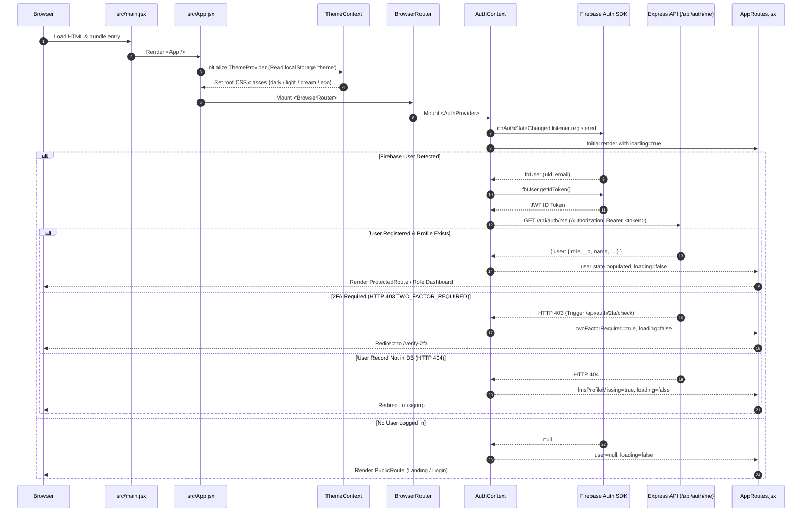
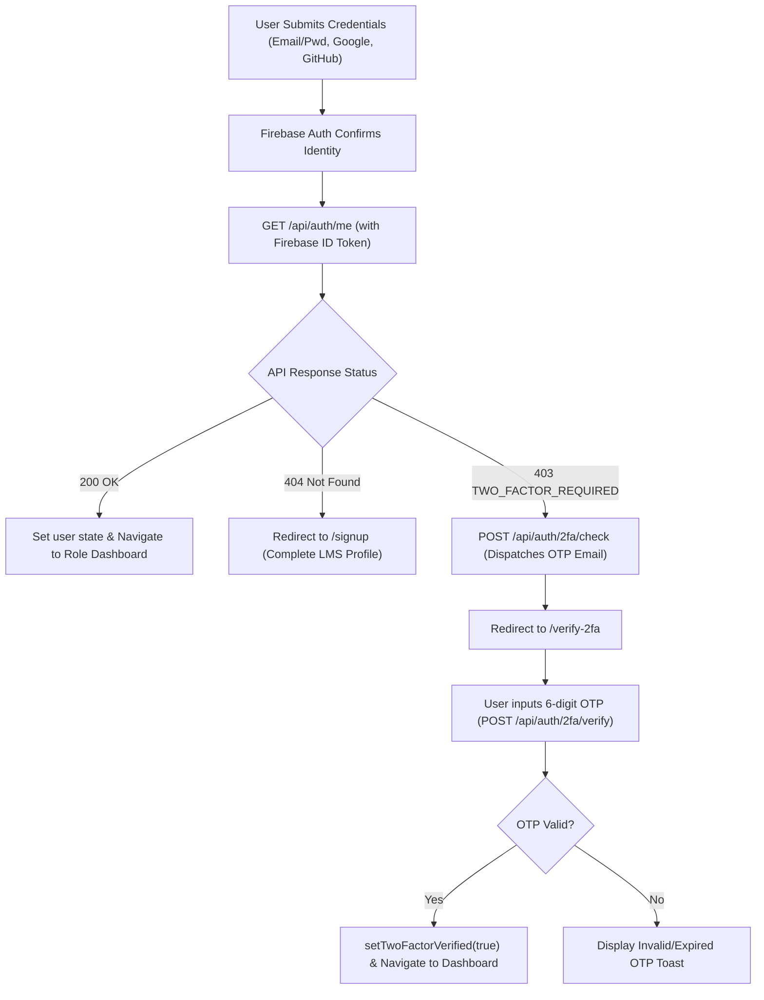

# SHNOOR LMS — Frontend Architecture & Technical Overview

> **Document Version:** 1.0.0  
> **Target Audience:** Engineering Leads, Senior Developers, QA Engineers, and Technical Onboarders  
> **Status:** Production-Grade Documentation  
> **Last Updated:** October 2026  

---

## 📑 Table of Contents

1. [Executive Summary & Purpose](#1-executive-summary--purpose)
2. [Key Features & User-Facing Functionality](#2-key-features--user-facing-functionality)
3. [Technology Stack & Dependency Matrix](#3-technology-stack--dependency-matrix)
4. [Tooling, Package Management & Build Pipeline](#4-tooling-package-management--build-pipeline)
5. [Repository & Directory Architecture](#5-repository--directory-architecture)
6. [Application Entry Point & Bootstrap Flow](#6-application-entry-point--bootstrap-flow)
7. [High-Level System Architecture](#7-high-level-system-architecture)
8. [Module & Layer Responsibilities](#8-module--layer-responsibilities)
9. [State Management & Data Persistence Strategy](#9-state-management--data-persistence-strategy)
10. [Styling Architecture, Design Tokens & Theming](#10-styling-architecture-design-tokens--theming)
11. [Authentication, 2FA & Authorization Architecture](#11-authentication-2fa--authorization-architecture)
12. [Frontend-to-Backend Communication Architecture](#12-frontend-to-backend-communication-architecture)
13. [Environment Configuration & Variables](#13-environment-configuration--variables)
14. [Local Development, Build & Deployment Guide](#14-local-development-build--deployment-guide)
15. [Quality Assurance, Linting & Testing Status](#15-quality-assurance-linting--testing-status)
16. [Key Architectural Decisions & Module Dependencies](#16-key-architectural-decisions--module-dependencies)
17. [Known Limitations, Technical Debt & Recommendations](#17-known-limitations-technical-debt--recommendations)

---

## 1. Executive Summary & Purpose

**SHNOOR LMS Frontend** (`lms-frontend`) is an enterprise-grade, single-page web application (SPA) providing an interactive digital learning ecosystem. It delivers three dedicated, role-scoped portals:
- **Student Portal**: Video lecture playback, progress tracking, assignment submissions, interactive quizzes, proctored examinations, certificates, code challenge practice arena, peer course reviews, and course queries.
- **Instructor Portal**: Curriculum authoring, video module uploads, automated and manual assignment grading, quiz and examination builders with AI-powered question generation, student progress analytics, and discussion facilitation.
- **Administrator Portal**: System-wide user lifecycle management, category taxonomies, course oversight, audit logging for AI chatbot conversations, compliance reporting, and business analytics.

In addition to portal workflows, the frontend features real-time course group discussions and direct peer messaging, an AI-powered conversational assistant, anti-cheat detection during examinations, multi-theme visual customization, and client-side data export capabilities.

---

## 2. Key Features & User-Facing Functionality

### 2.1. Authentication & Security
- **Multi-Provider Authentication**: Email/Password login and registration backed by Firebase Authentication, alongside one-click OAuth via Google and GitHub.
- **Two-Factor Authentication (2FA)**: Mandatory or optional email-based 6-digit OTP verification flow triggered automatically upon credential verification.
- **Role-Based Routing & Session Recovery**: Automated redirect to role-specific dashboards (`Student`, `Instructor`, `Admin`), coupled with an idle-session warning modal (`SessionTimeoutModal`).
- **Profile Self-Service**: Avatar upload, account info management, password modification, and two-factor toggle in `ProfileSettings`.

### 2.2. Course Discovery & Learning
- **Catalog Browsing & Search**: Search by keywords, category filtering, and sorting (`CourseList`) with local caching (`utils/cache.js`).
- **Course Detail & Curriculum Preview**: Comprehensive syllabus breakdown, instructor profile, ratings summary, and enrollment triggers (`CourseDetails`).
- **Curriculum Player**: Split-screen learning console with video player, lecture notes, downloadable lesson resources, and completion checkoffs (`CourseLearn`).
- **Peer Reviews**: Star ratings and qualitative student feedback with summary distribution bars (`components/reviews`).

### 2.3. Assessments, Quizzes & Examinations
- **Student Quizzes**: Timed quiz runner with single/multiple-choice options, real-time score evaluation, and answer breakdown (`QuizTest`).
- **Proctored Examination Suite**: Full-screen timed examination environment (`ActiveExamPage`) featuring question navigation, answer persistence, and anti-cheat indicators.
- **Live Leaderboard & Result Analytics**: Post-exam score breakdown with percentile calculations, podium standings (`ExamLeaderboardPage`), and rank analysis.
- **AI-Powered Question Authoring**: Instructor exam and quiz editors supporting manual question composition as well as automated question generation via backend AI (`AIGenerateQuestionsModal`).

### 2.4. Interactive Practice Arena
- **Monaco Code Editor**: Web-based programming workspace (`PracticeZone`) embedding Microsoft's Monaco Editor (`@monaco-editor/react`) for multi-language coding challenges.
- **Instructor Challenge Management**: Interface to create, edit, test, and publish programming problem statements (`AddPracticeChallenge`, `InstructorPracticeList`).

### 2.5. Real-Time Discussions & Direct Messaging
- **Course Group Discussions**: Persistent discussion rooms linked to enrolled courses (`DiscussionPage`).
- **Direct 1-on-1 Chats**: Direct peer messaging between students and instructors (`DirectChatRoom`).
- **WhatsApp-Style Features**:
  - Delete for Me vs. Delete for Everyone with real-time UI synchronization.
  - Forward messages across course groups and direct contacts with preview (`ForwardMessageModal`).
  - File attachments, images, stickers, and emoji reactions.
  - Read receipts, unread badges, and presence indicators.

### 2.6. Academic Support & Governance
- **Course Query Tickets**: Threaded Q&A ticket workflow allowing students to raise questions directly to instructors and admins (`StudentQueries`, `InstructorQueries`, `AdminQueries`).
- **Issue Reporting**: Form submission to flag technical or academic grievances (`MyReports`, `AdminReports`).
- **System Administration**: Full CRUD on users with role assignment (`UserManagement`), course status toggles (`CourseManagement`), category tree maintenance (`CategoryManagement`), and AI chatbot conversation logs (`AdminChatbotLogs`).

---

## 3. Technology Stack & Dependency Matrix

The frontend application is constructed strictly from the dependencies declared in [`package.json`](../package.json):

| Package / Tool | Version | Architectural Purpose in Application |
| :--- | :--- | :--- |
| **React** | `^18.3.1` | Core UI library, providing declarative component composition and hooks. |
| **React DOM** | `^18.3.1` | DOM renderer for React in browser environments. |
| **Vite** | `^6.0.1` | Next-generation frontend build tool, local dev server, and Rollup bundler. |
| **React Router DOM** | `^6.28.0` | Client-side routing, nested routes, route guards, and URL synchronization. |
| **Tailwind CSS** | `^3.4.19` | Utility-first styling engine, configured for dark mode and design tokens. |
| **PostCSS** | `^8.5.28` | CSS transformation pipeline tool powering Tailwind CSS processing. |
| **Autoprefixer** | `^10.6.1` | PostCSS plugin parsing CSS and appending vendor prefixes automatically. |
| **Firebase** | `^12.19.0` | Client SDK providing Firebase Authentication (Email, Google, GitHub, ID token refresh). |
| **Axios** | `^1.20.0` | Promise-based HTTP client with request/response interceptors for API token injection. |
| **Socket.IO Client** | `^4.8.4` | WebSocket client for real-time messaging, notifications, and presence events. |
| **Framer Motion** | `^13.4.0` | Animation engine for transitions, modal backdrops, dropdowns, and mobile drawers. |
| **Recharts** | `^3.10.1` | Declarative charting library for KPI cards, student trends, and admin analytics. |
| **@monaco-editor/react** | `^4.7.0` | In-browser code editor powering the Interactive Practice Arena. |
| **Lucide React** | `^0.469.0` | Iconography suite providing tree-shaken SVG icons across all views. |
| **React Hot Toast** | `^2.6.1` | Lightweight, accessible notification toast system. |
| **jsPDF** | `^4.2.1` | Client-side PDF generation engine for certificates and reports. |
| **jspdf-autotable** | `^5.0.8` | Plugin for jsPDF to render tabular data into PDF documents. |
| **XLSX** | `^0.18.5` | Spreadsheet parser and builder for client-side Excel data exports. |
| **@babel/runtime** | `^8.0.7` | Polyfill runtime helpers for transpiled code execution. |
| **react-is** | `^19.3.0` | Runtime React element type inspection helper. |

---

## 4. Tooling, Package Management & Build Pipeline

- **Node Engine Support**: Node.js v18.x or v20.x recommended.
- **Package Manager**: `npm` (utilizing `package-lock.json` for deterministic dependency trees).
- **Vite Configuration** ([`vite.config.js`](../vite.config.js)):
  - `@vitejs/plugin-react`: Fast Refresh and JSX transformation.
  - **Code Splitting (`manualChunks`)**: Rollup output configuration partitions third-party libraries into isolated vendor chunks to minimize entry chunk payload and accelerate First Contentful Paint:
    - `vendor-react`: `react`, `react-dom`, `react-router-dom`
    - `vendor-firebase`: `firebase/app`, `firebase/auth`
    - `vendor-monaco`: `@monaco-editor/react`
    - `vendor-recharts`: `recharts`
    - `vendor-export`: `jspdf`, `jspdf-autotable`, `xlsx`
    - `vendor-motion`: `framer-motion`
    - `vendor-icons`: `lucide-react`
    - `vendor-socket`: `socket.io-client`
- **Output Artifacts**: Static files built into `dist/` ready for immutable CDN edge deployment (e.g. Vercel).

---

## 5. Repository & Directory Architecture

```
FRONTEND/
├── index.html                      # HTML entry template, web fonts, SEO metadata
├── package.json                    # Project metadata, scripts, and dependencies
├── package-lock.json               # Deterministic dependency tree lockfile
├── postcss.config.js               # PostCSS configuration (Tailwind & Autoprefixer)
├── tailwind.config.js              # Tailwind theme, colors, typography, glassmorphism tokens
├── vercel.json                     # Vercel deployment rewrites, caching & security headers
├── vite.config.js                  # Vite configuration, React plugin & Rollup chunking
├── .env.example                    # Blueprint for client environment variables
├── public/                         # Static uncompiled assets
│   ├── chat-bg-dark.png            # Discussion room dark wallpaper
│   ├── chat-bg-light.png           # Discussion room light wallpaper
│   ├── hero-vector.png             # Landing page vector illustration
│   ├── robots.txt                  # Search engine crawl directives
│   ├── shnoor-logo.png             # Core brand mark
│   ├── sitemap.xml                 # Canonical XML search index sitemap
│   └── sw.js                       # Service worker stub
└── src/
    ├── main.jsx                    # React entry DOM root mount
    ├── App.jsx                     # Top-level providers, toasts, global modals & chatbot
    ├── configs/                    # Third-party service initializations
    │   └── firebase.js             # Firebase App and Auth instances
    ├── context/                    # Shared state context providers
    │   ├── AuthContext.jsx         # User identity, Firebase token exchange, role verification
    │   ├── NotificationContext.jsx # In-app alerts, unread counts, native push triggers
    │   └── ThemeContext.jsx        # Multi-theme state switcher (dark, light, cream, eco)
    ├── routes/                     # Application routing engine
    │   └── AppRoutes.jsx           # Lazy route definitions, Suspense, role guards (RBAC)
    ├── services/                   # Backend HTTP API and WebSocket clients
    │   ├── admin.service.js        # Admin user and profile management
    │   ├── analytics.service.js    # Metric aggregation for students, mentors, admins
    │   ├── api.service.js          # Central Axios client with bearer token interceptor
    │   ├── assignment.service.js   # Homework creation, upload, submission & grading
    │   ├── chatbot.service.js      # AI learning assistant chat endpoints and log inspection
    │   ├── courseQuery.service.js  # Threaded academic Q&A query tickets
    │   ├── directChat.service.js   # 1-to-1 real-time messaging, media, reactions
    │   ├── discussion.service.js   # Course group discussion rooms, forwarding, deletion
    │   ├── exam.service.js         # Proctored exams, attempts, submissions, AI generation
    │   ├── export.service.js       # Admin database export downloads
    │   ├── firebaseAuth.service.js # Firebase auth wrappers (Google, GitHub, email)
    │   ├── instructor.service.js   # Instructor directory and profile endpoints
    │   ├── quiz.service.js         # Course quizzes, AI question builder, evaluations
    │   ├── report.service.js       # Grievance reporting and resolution workflows
    │   ├── review.service.js       # Course review submission, rating calculation
    │   ├── socket.service.js       # Socket.IO connection manager, reconnect token refresh
    │   └── student.service.js      # Student profile queries and updates
    ├── styles/                     # CSS stylesheets and theme declarations
    │   ├── auth.css                # Authentication forms and brand frame styles
    │   ├── index.css               # Global baseline typography, scrollbars, utility classes
    │   ├── landing.css             # Landing page animations and banners
    │   ├── navbar.css              # Navigation bar glassmorphism styles
    │   ├── tailwind.css            # Tailwind directives (@tailwind base, components, utilities)
    │   └── theme.css               # CSS custom properties for dark, light, cream, and eco themes
    ├── utils/                      # Helper utilities and data transformers
    │   ├── auth.js                 # Role-to-dashboard path resolver
    │   ├── browserNotification.js  # HTML5 native notification permission requester
    │   ├── cache.js                # LocalStorage TTL-based caching utility
    │   ├── frameLoader.js          # Dynamic script/frame loading helper
    │   └── stickers.js             # Discussion sticker catalog definitions
    ├── components/                 # Reusable UI component library
    │   ├── analytics/              # KPICard, CompletionDonutChart, TrendCharts
    │   ├── Chatbot/                # FloatingChatbot widget
    │   ├── discussions/            # MessageBubble, MessageComposer, ForwardMessageModal, etc.
    │   ├── exam/                   # QuestionNavigator, ExamTimer, LeaderboardPodium, etc.
    │   ├── queries/                # QueryCard, QueryConversation, CreateQueryModal, etc.
    │   ├── reviews/                # StarRating, ReviewCard, ReviewForm, ReviewSummary
    │   ├── AuthLayout.jsx          # Dual-column split layout for authentication
    │   ├── CourseCard.jsx          # Standardized course card with thumbnail, rating, level
    │   ├── DashboardLayout.jsx     # Responsive portal sidebar, header, theme & account drawer
    │   ├── Footer.jsx              # Global footer with accessible social navigation
    │   ├── LoadingScreen.jsx       # Full-screen branded loading indicator
    │   ├── Navbar.jsx              # Floating navigation bar for public views
    │   ├── NotificationDropdown.jsx# Notification bell dropdown with unread counts
    │   ├── RouteLoadingFallback.jsx# Lightweight Suspense route transition skeleton
    │   ├── SessionTimeoutModal.jsx # Inactivity timeout alert and auto-logout handler
    │   └── TwoFactorToggle.jsx     # Reusable switch to enable/disable email 2FA
    └── pages/                      # Page view controllers
        ├── ActiveExamPage.jsx      # Proctored full-screen exam engine
        ├── CourseDetails.jsx       # Course landing page, curriculum preview & enroll action
        ├── CourseList.jsx          # Public course directory with search and filtering
        ├── ExamDetailsPage.jsx     # Exam overview, instructions, attempt starter
        ├── ExamLeaderboardPage.jsx # Exam ranking table and percentile podium
        ├── ExamResultPage.jsx      # Exam score summary, question review
        ├── ForgotPassword.jsx      # Password reset email submission
        ├── LandingPage.jsx         # High-conversion public marketing home page
        ├── Login.jsx               # Email, Google, and GitHub sign-in page
        ├── PremiumCourseDetailsPage.jsx # Specialized premium course landing view
        ├── PremiumCoursesPage.jsx  # Premium curated catalog view
        ├── Signup.jsx              # Role-aware registration (Student, Instructor, Admin)
        ├── VerifyCertificate.jsx   # Public certificate verification by unique ID
        ├── VerifyTwoFactor.jsx     # 6-digit OTP verification page
        └── dashboards/             # Authenticated role-specific portal screens
            ├── AdminDashboard.jsx
            ├── DiscussionPage.jsx
            ├── InstructorDashboard.jsx
            ├── ProfileSettings.jsx
            ├── StudentDashboard.jsx
            ├── admin/              # UserManagement, CourseManagement, CategoryManagement, etc.
            ├── instructor/         # MyCourses, CreateCourse, EditCourse, CourseContent, etc.
            ├── reports/            # MyReports, AdminReports
            └── student/            # CourseLearn, StudentMyCourses, StudentQuizzes, QuizTest, etc.
```

---

## 6. Application Entry Point & Bootstrap Flow

The bootstrap sequence executes as follows:



---

## 7. High-Level System Architecture

```mermaid
graph TD
    subgraph Client_Layer ["Client-Side Browser Runtime"]
        DOM["index.html + React 18 Root"]
        AppComp["App.jsx (Global Frame, Toaster, Chatbot, Modals)"]
        
        subgraph Context_Layer ["State & Context Infrastructure"]
            AC["AuthContext (User, Role, Firebase Auth, 2FA)"]
            TC["ThemeContext (Dark, Light, Cream, Eco)"]
            NC["NotificationContext (Alerts, Unread Count, Push)"]
        end
        
        subgraph Routing_Layer ["Navigation & Guards (AppRoutes.jsx)"]
            PublicRoutes["Public Views (Landing, Courses, Login, Signup)"]
            StudentGuard["ProtectedRoute (Role: Student)"]
            InstructorGuard["ProtectedRoute (Role: Instructor)"]
            AdminGuard["ProtectedRoute (Role: Admin)"]
        end
        
        subgraph Views_Layer ["Portals & Interactive Consoles"]
            StudentViews["Student Portal (Learn, Exams, Quizzes, Practice)"]
            InstructorViews["Instructor Portal (Courses, Assignments, Analytics)"]
            AdminViews["Admin Portal (Users, Categories, Exports, Chatbot Logs)"]
            DiscussionViews["Real-Time Discussions & Direct Chat Rooms"]
        end
        
        subgraph Service_Layer ["Transport & API Services"]
            AxiosClient["api.service.js (Axios Instance + Bearer Interceptor)"]
            SocketClient["socket.service.js (Socket.IO Real-Time Client)"]
            CacheUtil["utils/cache.js (TTL LocalStorage Cache)"]
        end
    end

    subgraph External_Services ["External & Cloud Infrastructure"]
        FirebaseService["Firebase Authentication"]
        BackendAPI["Express 5 REST API (Render)"]
        SocketServer["Socket.IO Server (Render)"]
        CloudinaryCDN["Cloudinary Media CDN"]
    end

    DOM --> AppComp
    AppComp --> Context_Layer
    Context_Layer --> Routing_Layer
    Routing_Layer --> Views_Layer
    Views_Layer --> Service_Layer
    
    Service_Layer -->|Exchange ID Token| FirebaseService
    Service_Layer -->|Bearer JWT Requests| BackendAPI
    Service_Layer -->|WebSockets (Events, Rooms)| SocketServer
    Views_Layer -.->|Direct Image & Video Load| CloudinaryCDN
```

---

## 8. Module & Layer Responsibilities

| Layer / Directory | Primary Responsibility | Key Files |
| :--- | :--- | :--- |
| **`src/context/`** | Application-wide ambient state providers. Exposes hooks consumed across routes. | `AuthContext.jsx`, `ThemeContext.jsx`, `NotificationContext.jsx` |
| **`src/routes/`** | Route declarations, route code splitting (`lazy`), route guards, role authorization. | `AppRoutes.jsx` |
| **`src/pages/`** | Screen-level controllers fetching initial datasets and orchestrating UI components. | `LandingPage.jsx`, `CourseDetails.jsx`, `ActiveExamPage.jsx` |
| **`src/pages/dashboards/`** | Role-restricted screens for Student, Instructor, and Admin workspaces. | `StudentDashboard.jsx`, `InstructorDashboard.jsx`, `AdminDashboard.jsx` |
| **`src/components/`** | Presentational and interactive reusable components. | `CourseCard.jsx`, `DashboardLayout.jsx`, `AuthLayout.jsx` |
| **`src/services/`** | Pure API abstraction layer communicating with backend endpoints and WebSockets. | `api.service.js`, `socket.service.js`, `discussion.service.js` |
| **`src/utils/`** | Stateless functional utilities (auth path resolution, cache management, stickers). | `auth.js`, `cache.js`, `stickers.js` |
| **`src/styles/`** | Theme definitions, CSS variables, glassmorphic layout utility classes. | `theme.css`, `tailwind.css`, `index.css` |

---

## 9. State Management & Data Persistence Strategy

State in SHNOOR LMS is distributed intentionally across five distinct tiers:

1. **Ambient Context State (Global)**:
   - `AuthContext`: Contains `{ user, firebaseUser, loading, lmsProfileMissing, twoFactorRequired, twoFactorVerified }`. Handles login, logout, and token refresh.
   - `ThemeContext`: Current active theme name (`dark`, `light`, `cream`, `eco`).
   - `NotificationContext`: Real-time notification feed, unread notification count, browser push authorization state.
2. **Local Component State (`useState`, `useReducer`)**:
   - Manages component-scoped UI toggles (dropdown open/close, active tab index, modal visibility, form inputs, local filters).
3. **Persistent Browser Storage (`localStorage`)**:
   - `theme`: User's preferred color theme (defaults to `dark`).
   - `sidebarCollapsed`: User's layout preference for portal navigation bar (`'true'` or `'false'`).
   - `lms_cache_*`: Key-value cache items managed by [`utils/cache.js`](../src/utils/cache.js) with expiration timestamps (used for public course listings and category menus).
4. **URL / Route State (`useSearchParams`, `useParams`, `useLocation`)**:
   - Identifiers passed in routes (e.g., `:id`, `:quizId`, `:examId`, `:attemptId`, `:studentId`).
   - Filters and queries persisted in query parameters for shareability.
5. **Real-Time Ephemeral State (Socket.IO)**:
   - Active typing indicators, online/offline presence tracking, socket room memberships, real-time message feeds in `DiscussionPage` and `DirectChatRoom`.

---

## 10. Styling Architecture, Design Tokens & Theming

The application employs **Tailwind CSS** combined with CSS Custom Properties (`src/styles/theme.css`) to implement a comprehensive glassmorphism theme system:

### 10.1. Available Themes
- **Dark Theme (`dark`)**: Deep charcoal/slate foundation (`#0f172a`), vivid indigo/violet accents, high-contrast typography.
- **Light Theme (`light`)**: Crisp white/gray surface (`#ffffff`, `#f8fafc`), clean borders, indigo accents.
- **Cream Theme (`theme-cream`)**: Warm pastel parchment background (`#fdfbf7`), amber/warm accents.
- **Eco Theme (`theme-eco`)**: Nature-inspired emerald palette (`#064e3b`, `#10b981`), dark surface with vibrant green highlights.

### 10.2. Design System Utility Classes
- `.lms-glass-card`: Semi-transparent background with backdrop blur, subtle borders, and soft shadows.
- `.lms-glass-sidebar`: Glass-styled navigation rail with collapsible width (`w-20` to `w-64`).
- `.lms-glass-header`: Frosted navigation bar fixed atop the dashboard viewport.
- Design tokens defined in `tailwind.config.js`:
  - Background: `var(--lms-bg)`
  - Surface: `var(--lms-surface)` / `var(--lms-surface-elevated)`
  - Text: `var(--lms-text-primary)` / `var(--lms-text-secondary)` / `var(--lms-text-muted)`
  - Accent: `var(--lms-accent)` / `var(--lms-accent-hover)`

---

## 11. Authentication, 2FA & Authorization Architecture

### 11.1. Identification & Token Exchange
1. When a user signs in via email/password, Google popup, or GitHub popup, Firebase Auth issues a short-lived JSON Web Token (JWT ID Token).
2. The Axios interceptor in [`services/api.service.js`](../src/services/api.service.js) intercepts outgoing requests, calls `auth.currentUser.getIdToken()`, and attaches the token in the `Authorization: Bearer <token>` header.
3. The backend Express API decodes and verifies the token against Firebase Admin SDK, matches the `firebaseUid` to a MongoDB `User` document, and returns the LMS user profile.

### 11.2. Two-Factor Authentication (2FA) Flow


### 11.3. Role-Based Access Control (RBAC)
Routes in [`AppRoutes.jsx`](../src/routes/AppRoutes.jsx) are protected by `<ProtectedRoute roles={[...]} />`. The guard evaluates:
- If `loading === true`: renders `<LoadingScreen />`.
- If `lmsProfileMissing === true`: redirects to `/signup`.
- If `twoFactorRequired === true`: redirects to `/verify-2fa`.
- If `!user || !user.role`: redirects to `/login`.
- If `roles` does not include `user.role`: redirects to `getDashboardPath(user.role)`.

---

## 12. Frontend-to-Backend Communication Architecture

### 12.1. REST API Client (`api.service.js`)
- Base URL resolved via `import.meta.env.VITE_API_BASE_URL` with fallback to `VITE_API_URL`.
- Default headers: `Content-Type: application/json`.
- `withCredentials: true` enabled for cross-origin cookie support.
- Automatic Firebase ID token retrieval and bearer header injection.
- Centralized error response formatting.

### 12.2. Real-Time WebSockets (`socket.service.js`)
- Connects to `VITE_SOCKET_URL` (or falls back to `VITE_API_BASE_URL`).
- Socket initialization passes Firebase ID Token inside `auth: { token }`.
- Automatically catches `connect_error` due to token expiry, fetches a refreshed Firebase token, and reconnects.
- Real-time rooms supported:
  - User notification channel (`notification:new`)
  - Course discussion group room (`discussion:<id>`)
  - Direct 1-on-1 chat room (`conversation:<id>`)
  - Message lifecycle events (`message:new`, `message:deleted`, `message:reaction`, `message:forwarded`)

---

## 13. Environment Configuration & Variables

Environment variables are defined in `.env` (using `.env.example` as a template). In accordance with Vite conventions, all client-exposed variables must begin with the `VITE_` prefix:

| Variable Name | Required | Description |
| :--- | :--- | :--- |
| `VITE_API_BASE_URL` | **Yes** | Fully qualified URL of the backend REST API (e.g. `https://lms-backend-9bwv.onrender.com` or `http://localhost:5000`). |
| `VITE_SOCKET_URL` | Optional | URL of the Socket.IO server. Defaults to `VITE_API_BASE_URL` if omitted. |
| `VITE_FIREBASE_API_KEY` | **Yes** | Firebase Web API key for authentication initialization. |
| `VITE_FIREBASE_AUTH_DOMAIN` | **Yes** | Firebase authentication domain (e.g. `your-app.firebaseapp.com`). |
| `VITE_FIREBASE_PROJECT_ID` | **Yes** | Firebase project identifier. |
| `VITE_FIREBASE_STORAGE_BUCKET` | **Yes** | Firebase Cloud Storage bucket identifier. |
| `VITE_FIREBASE_MESSAGING_SENDER_ID` | **Yes** | Firebase Cloud Messaging numeric sender ID. |
| `VITE_FIREBASE_APP_ID` | **Yes** | Unique Firebase web application ID. |
| `VITE_FIREBASE_MEASUREMENT_ID` | Optional | Google Analytics measurement ID for Firebase. |

> [!CAUTION]
> Never commit actual API keys or secret values into version control. Ensure `.env` is listed in `.gitignore`.

---

## 14. Local Development, Build & Deployment Guide

### 14.1. Prerequisites
- Node.js `v18.x` or `v20.x`
- npm `v9.x` or `v10.x`

### 14.2. Installation & Setup
```bash
# Navigate to the frontend directory
cd FRONTEND

# Install dependencies deterministically
npm install

# Create local environment configuration from template
cp .env.example .env
# Edit .env with your local backend URL and Firebase credentials
```

### 14.3. Verified Scripts
From [`package.json`](../package.json):

```bash
# Start local Vite development server with Hot Module Replacement (default: http://localhost:5173)
npm run dev

# Compile production-optimized assets with Rollup chunk partitioning into /dist
npm run build

# Preview the compiled production build locally
npm run preview
```

### 14.4. Deployment (Vercel)
The project includes a production-tested [`vercel.json`](../vercel.json):
- SPA rewrite routing all HTML navigation requests to `/index.html`.
- Exclusion rules ensuring `robots.txt`, `sitemap.xml`, and `/assets/*` are served directly.
- 1-year immutable cache headers (`Cache-Control: public, max-age=31536000, immutable`) for compiled `/assets/(.*)`.
- HTTP Security headers (`X-Content-Type-Options: nosniff`, `X-Frame-Options: SAMEORIGIN`, `Referrer-Policy: strict-origin-when-cross-origin`).

---

## 15. Quality Assurance, Linting & Testing Status

- **Automated Test Runners**: *Not currently implemented.* There is no Jest, Vitest, or Cypress runner configured in `package.json`.
- **Static Compilation & Bundle Analysis**: Verified via `npm run build` (`vite build`). Zero compilation errors, all chunks tree-shaken and gzipped.
- **Lighthouse Performance Metrics (Post-Optimization)**:
  - Entry bundle reduced by **86%** from **2,788 kB** down to **105 kB** (37 kB gzipped).
  - Code splitting implemented across all 40+ routes.
  - Zero layout shift (CLS < 0.001) due to explicit image dimensions and aspect ratios.
  - Asynchronous font preloading eliminating render-blocking CSS.

---

## 16. Key Architectural Decisions & Module Dependencies

```mermaid
graph LR
    subgraph Core
        React[React 18]
        Vite[Vite 6]
        Router[React Router 6]
    end
    
    subgraph Security
        FB[Firebase Auth]
        Axios[Axios Client]
    end

    subgraph Feature_Libs
        Monaco[@monaco-editor/react]
        Recharts[Recharts]
        SocketIO[Socket.io-client]
        Export[jsPDF & XLSX]
    end

    Core --> Security
    Core --> Feature_Libs
    Security --> Axios
```

1. **Decoupled Auth Architecture**: Authentication credentials are delegated to Google Firebase; authorization, permissions, and roles are owned exclusively by MongoDB and Express.
2. **Lazy Route Code Splitting**: All pages are loaded via `React.lazy()` with a Suspense boundary (`RouteLoadingFallback.jsx`), preventing Monaco, Recharts, and PDF generation code from bloating the public landing bundle.
3. **Resilient WebSockets**: `socket.service.js` automatically hooks into `reconnect_attempt` and `connect_error` to refresh expired Firebase tokens without interrupting the user session.

---

## 17. Known Limitations, Technical Debt & Recommendations

1. **Unrouted Admin Component (`AdminExportCenter.jsx`)**: The file [`src/pages/dashboards/admin/AdminExportCenter.jsx`](../src/pages/dashboards/admin/AdminExportCenter.jsx) exists in the repository with complete UI for dataset downloads, but is not currently registered in [`src/routes/AppRoutes.jsx`](../src/routes/AppRoutes.jsx).  
   *Recommendation:* Register the route `/admin/exports` in `AppRoutes.jsx` and add a sidebar link in `DashboardLayout.jsx`.
2. **Automated Unit & Integration Tests**: No automated test framework (Vitest or Jest) is currently installed.  
   *Recommendation:* Introduce Vitest and `@testing-library/react` to test core authentication and route guard logic.
3. **TypeScript Migration**: The codebase is authored in standard JavaScript (`.jsx`).  
   *Recommendation:* Progressively adopt TypeScript (`.tsx`) starting with API service response definitions and common models.
4. **Hardcoded Course Data in Landing Page**: Sections of [`LandingPage.jsx`](../src/pages/LandingPage.jsx) utilize hardcoded course arrays for trending courses instead of pulling live data from `/api/courses`.  
   *Recommendation:* Connect the trending section to a backend `/api/courses/trending` endpoint with local cache fallback.
