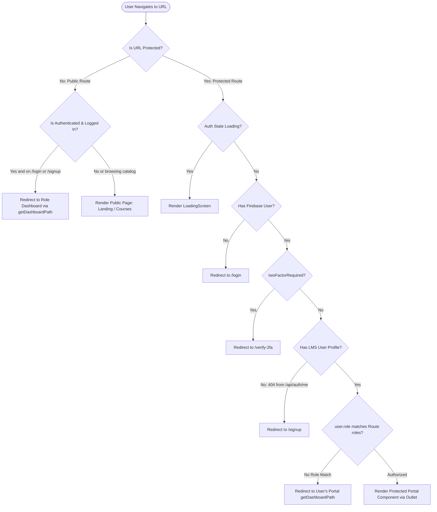

# SHNOOR LMS — Routing Architecture & Navigation Reference

> **Document Version:** 1.0.0  
> **Target Audience:** Frontend Engineers, System Architects, QA Engineers  
> **Status:** Production-Grade Documentation  
> **Source Location:** [`src/routes/AppRoutes.jsx`](../src/routes/AppRoutes.jsx)  
> **Last Updated:** October 2026  

---

## 📑 Table of Contents

1. [Routing Architecture & Technology Overview](#1-routing-architecture--technology-overview)
2. [Route Guards & Protection Hierarchy](#2-route-guards--protection-hierarchy)
3. [Navigation Flow & Guard Decision Flowchart](#3-navigation-flow--guard-decision-flowchart)
4. [Public & Marketing Routes](#4-public--marketing-routes)
5. [Authentication & Verification Routes](#5-authentication--verification-routes)
6. [Student Portal Routes](#6-student-portal-routes)
7. [Instructor Portal Routes](#7-instructor-portal-routes)
8. [Shared Instructor & Administrator Routes](#8-shared-instructor--administrator-routes)
9. [Administrator Portal Routes](#9-administrator-portal-routes)
10. [Universal Authenticated Routes](#10-universal-authenticated-routes)
11. [Dynamic URL Parameters & Route Patterns](#11-dynamic-url-parameters--route-patterns)
12. [Programmatic Navigation & Deep-Link Triggers](#12-programmatic-navigation--deep-link-triggers)
13. [Session Expiration & Inactivity Flow](#13-session-expiration--inactivity-flow)
14. [Route Loading States & Fallback Handling](#14-route-loading-states--fallback-handling)
15. [Audit: Discovered Redundancies, Unreachable Routes & Technical Debt](#15-audit-discovered-redundancies-unreachable-routes--technical-debt)
16. [Master Route Reference Table](#16-master-route-reference-table)

---

## 1. Routing Architecture & Technology Overview

SHNOOR LMS uses **React Router v6** (`react-router-dom@^6.28.0`) as its single declarative routing engine:
- The top-level browser history router (`<BrowserRouter>`) is mounted in [`src/App.jsx`](../src/App.jsx) wrapping all context providers (`ThemeProvider`, `AuthProvider`, `NotificationProvider`).
- Route definitions, route guarding, and dynamic code splitting are consolidated in [`src/routes/AppRoutes.jsx`](../src/routes/AppRoutes.jsx).
- Every route component is imported lazily via `React.lazy()` and encapsulated inside a top-level `<Suspense>` boundary powered by [`src/components/RouteLoadingFallback.jsx`](../src/components/RouteLoadingFallback.jsx).
- Role-based redirect path resolution is handled by [`src/utils/auth.js`](../src/utils/auth.js) via `getDashboardPath(role)`.

---

## 2. Route Guards & Protection Hierarchy

All routing decisions are mediated by four custom guard wrappers defined directly in [`src/routes/AppRoutes.jsx`](../src/routes/AppRoutes.jsx):

### 2.1. `ProtectedRoute`
- **Location**: [`src/routes/AppRoutes.jsx#L64-L99`](../src/routes/AppRoutes.jsx)
- **Signature**: `<ProtectedRoute roles={["Student" | "Instructor" | "Admin"]} />`
- **Behavior**:
  1. **Loading State**: If `loading === true`, renders the full-screen `<LoadingScreen />` while Firebase checks session persistence.
  2. **Profile Incompletion**: If `lmsProfileMissing === true` (authenticated in Firebase but no document in MongoDB), redirects to `/signup`.
  3. **2FA Enforcement**: If `firebaseUser` is present and `twoFactorRequired === true`, redirects to `/verify-2fa`.
  4. **Unauthenticated Redirect**: If `!user || !user.role`, saves the session state and redirects to `/login`.
  5. **Role Mismatch Redirect**: If `roles` does not contain `user.role`:
     - Resolves the user's rightful dashboard using `getDashboardPath(user.role)`.
     - Redirects the user to their designated portal, preventing cross-role access (e.g. Student attempting to open `/admin/dashboard` is redirected to `/student/dashboard`).
  6. **Authorized**: Renders child routes via `<Outlet />`.

### 2.2. `PublicOnlyRoute`
- **Location**: [`src/routes/AppRoutes.jsx#L101-L124`](../src/routes/AppRoutes.jsx)
- **Signature**: `<PublicOnlyRoute />`
- **Protected Routes**: `/login`, `/signup`, `/forgot-password`.
- **Behavior**:
  - Allows immediate rendering for unauthenticated visitors without waiting for Firebase initialization to complete (eliminating FCP/LCP delays on login).
  - If the visitor is already authenticated (`user?.role`), redirects to `getDashboardPath(user.role)`.
  - If `twoFactorRequired === true`, redirects to `/verify-2fa`.

### 2.3. `HomeRoute`
- **Location**: [`src/routes/AppRoutes.jsx#L126-L147`](../src/routes/AppRoutes.jsx)
- **Signature**: `<HomeRoute />`
- **Protected Route**: `/`
- **Behavior**:
  - If unauthenticated, displays the public marketing home page (`<LandingPage />`).
  - If authenticated, automatically redirects the user to their assigned role portal (`/student/dashboard`, `/instructor/dashboard`, or `/admin/dashboard`).
  - If 2FA is required, redirects to `/verify-2fa`.

### 2.4. `TwoFactorRoute`
- **Location**: [`src/routes/AppRoutes.jsx#L149-L169`](../src/routes/AppRoutes.jsx)
- **Signature**: `<TwoFactorRoute />`
- **Protected Route**: `/verify-2fa`
- **Behavior**:
  - If `!firebaseUser`, redirects to `/login`.
  - If `!twoFactorRequired`, redirects to `/`.
  - Renders `<VerifyTwoFactor />` via `<Outlet />` when an OTP challenge is pending.

---

## 3. Navigation Flow & Guard Decision Flowchart

---

## 4. Public & Marketing Routes

These routes are publicly accessible without authentication credentials:

| URL Path | Component | Source File | Purpose & Behavior |
| :--- | :--- | :--- | :--- |
| `/` | `LandingPage` (via `HomeRoute`) | [`src/pages/LandingPage.jsx`](../src/pages/LandingPage.jsx) | High-conversion marketing landing page with hero vectors, countdown banner, popular categories, and student feedback. Redirects authenticated users to their role portal. |
| `/courses` | `CourseList` | [`src/pages/CourseList.jsx`](../src/pages/CourseList.jsx) | Full public course catalog with text search, category dropdown filter, sort controls, and course cards. |
| `/courses/:id` | `CourseDetails` | [`src/pages/CourseDetails.jsx`](../src/pages/CourseDetails.jsx) | Course landing page showing curriculum syllabus, instructor overview, student reviews, and the enrollment trigger. |
| `/premium-courses` | `PremiumCoursesPage` | [`src/pages/PremiumCoursesPage.jsx`](../src/pages/PremiumCoursesPage.jsx) | Curated catalog featuring premium and certified masterclasses. |
| `/course/:id` | `PremiumCourseDetailsPage` | [`src/pages/PremiumCourseDetailsPage.jsx`](../src/pages/PremiumCourseDetailsPage.jsx) | Detailed syllabus and pricing overview for premium course offerings. |
| `/verify-certificate/:certificateId?` | `VerifyCertificate` | [`src/pages/VerifyCertificate.jsx`](../src/pages/VerifyCertificate.jsx) | Public verification portal validating digital certificate hashes against the database. |

---

## 5. Authentication & Verification Routes

Encapsulated within `PublicOnlyRoute` or `TwoFactorRoute`:

| URL Path | Component | Source File | Guard Wrapper | Purpose & Behavior |
| :--- | :--- | :--- | :--- | :--- |
| `/login` | `Login` | [`src/pages/Login.jsx`](../src/pages/Login.jsx) | `PublicOnlyRoute` | Email/Password, Google OAuth, and GitHub OAuth sign-in. |
| `/signup` | `Signup` | [`src/pages/Signup.jsx`](../src/pages/Signup.jsx) | `PublicOnlyRoute` | Account registration supporting `Student`, `Instructor`, or `Admin` (requires secret admin registration token). |
| `/forgot-password` | `ForgotPassword` | [`src/pages/ForgotPassword.jsx`](../src/pages/ForgotPassword.jsx) | `PublicOnlyRoute` | Form to dispatch a password recovery email via Firebase. |
| `/verify-2fa` | `VerifyTwoFactor` | [`src/pages/VerifyTwoFactor.jsx`](../src/pages/VerifyTwoFactor.jsx) | `TwoFactorRoute` | 6-digit OTP challenge entry screen with resend timer and rate-limiting. |

---

## 6. Student Portal Routes

Protected by `<ProtectedRoute roles={["Student"]} />`. These views use [`src/components/DashboardLayout.jsx`](../src/components/DashboardLayout.jsx) configured with the Student navigation rail:

| URL Path | Component | Source File | Layout | Feature / Functional Area |
| :--- | :--- | :--- | :--- | :--- |
| `/student/dashboard` | `StudentDashboard` | [`src/pages/dashboards/StudentDashboard.jsx`](../src/pages/dashboards/StudentDashboard.jsx) | `DashboardLayout` | Overview showing active enrollments, course progress bars, recent assignments, and performance KPIs. |
| `/student/courses` | `CourseList` | [`src/pages/CourseList.jsx`](../src/pages/CourseList.jsx) | `DashboardLayout` | Browse all courses from within the student portal workspace. |
| `/student/courses/my` | `StudentMyCourses` | [`src/pages/dashboards/student/StudentMyCourses.jsx`](../src/pages/dashboards/student/StudentMyCourses.jsx) | `DashboardLayout` | Enrolled courses grid with quick links to continue learning. |
| `/student/courses/:id/learn` | `CourseLearn` | [`src/pages/dashboards/student/CourseLearn.jsx`](../src/pages/dashboards/student/CourseLearn.jsx) | Custom Full View | Video lecture playback console with chapter accordion, resource downloads, and completion markers. |
| `/student/quizzes` | `StudentQuizzes` | [`src/pages/dashboards/student/StudentQuizzes.jsx`](../src/pages/dashboards/student/StudentQuizzes.jsx) | `DashboardLayout` | List of quizzes assigned across all enrolled courses. |
| `/student/quizzes/:quizId/take` | `QuizTest` | [`src/pages/dashboards/student/QuizTest.jsx`](../src/pages/dashboards/student/QuizTest.jsx) | Custom Exam View | Interactive timed quiz runner with instant evaluation. |
| `/student/profile` | `ProfileSettings` | [`src/pages/dashboards/ProfileSettings.jsx`](../src/pages/dashboards/ProfileSettings.jsx) | `DashboardLayout` | Account profile updates, avatar image upload, and 2FA toggles. |
| `/student/certificates` | `StudentCertificates` | [`src/pages/dashboards/student/StudentCertificates.jsx`](../src/pages/dashboards/student/StudentCertificates.jsx) | `DashboardLayout` | Earned certificates repository with direct PDF download buttons. |
| `/student/certificates/view/:id` | `ViewCertificate` | [`src/pages/dashboards/student/ViewCertificate.jsx`](../src/pages/dashboards/student/ViewCertificate.jsx) | Custom View | Digital certificate render preview with verified badge and QR code. |
| `/student/analytics` | `StudentAnalytics` | [`src/pages/dashboards/instructor/StudentAnalytics.jsx`](../src/pages/dashboards/instructor/StudentAnalytics.jsx) | `DashboardLayout` | Charts showing quiz scores, assignments submitted, and study hours. |
| `/student/discussions` | `DiscussionPage` | [`src/pages/dashboards/DiscussionPage.jsx`](../src/pages/dashboards/DiscussionPage.jsx) | `DashboardLayout` | Course group discussion rooms and direct messaging. |
| `/student/calendar` | `StudentCalendar` | [`src/pages/dashboards/student/StudentCalendar.jsx`](../src/pages/dashboards/student/StudentCalendar.jsx) | `DashboardLayout` | Visual calendar highlighting assignment deadlines and exam dates. |
| `/student/reviews` | `StudentReviews` | [`src/pages/dashboards/student/StudentReviews.jsx`](../src/pages/dashboards/student/StudentReviews.jsx) | `DashboardLayout` | Central log of all reviews and ratings submitted by the student. |
| `/student/reports` | `MyReports` | [`src/pages/dashboards/reports/MyReports.jsx`](../src/pages/dashboards/reports/MyReports.jsx) | `DashboardLayout` | Submission and tracking of technical and academic grievance tickets. |
| `/student/practice` | `PracticeZone` | [`src/pages/dashboards/student/PracticeZone.jsx`](../src/pages/dashboards/student/PracticeZone.jsx) | Custom IDE View | Monaco Code Editor workspace for solving programming challenges. |
| `/student/queries` | `StudentQueries` | [`src/pages/dashboards/student/StudentQueries.jsx`](../src/pages/dashboards/student/StudentQueries.jsx) | `DashboardLayout` | Direct Q&A tickets submitted to course instructors. |
| `/exams` | `StudentExams` | [`src/pages/dashboards/student/StudentExams.jsx`](../src/pages/dashboards/student/StudentExams.jsx) | `DashboardLayout` | Registry of published examinations available to the student. |
| `/exams/:examId` | `ExamDetailsPage` | [`src/pages/ExamDetailsPage.jsx`](../src/pages/ExamDetailsPage.jsx) | `DashboardLayout` | Exam rules, syllabus, duration, passing criteria, and start modal. |
| `/exams/:examId/attempt` | `ActiveExamPage` | [`src/pages/ActiveExamPage.jsx`](../src/pages/ActiveExamPage.jsx) | Custom Proctored View | Proctored exam interface with countdown timer, anti-cheat detection, and auto-submit. |
| `/exams/:examId/result/:attemptId` | `ExamResultPage` | [`src/pages/ExamResultPage.jsx`](../src/pages/ExamResultPage.jsx) | `DashboardLayout` | Score card, percentile analysis, and question-by-question review. |

---

## 7. Instructor Portal Routes

Protected by `<ProtectedRoute roles={["Instructor"]} />`:

| URL Path | Component | Source File | Layout | Feature / Functional Area |
| :--- | :--- | :--- | :--- | :--- |
| `/instructor/dashboard` | `InstructorDashboard` | [`src/pages/dashboards/InstructorDashboard.jsx`](../src/pages/dashboards/InstructorDashboard.jsx) | `DashboardLayout` | Metric cards (total enrolled students, course revenue, active courses). |
| `/instructor/courses` | `MyCourses` | [`src/pages/dashboards/instructor/MyCourses.jsx`](../src/pages/dashboards/instructor/MyCourses.jsx) | `DashboardLayout` | Instructor's authored courses list with publish, edit, and delete triggers. |
| `/instructor/courses/my` | `MyCourses` | [`src/pages/dashboards/instructor/MyCourses.jsx`](../src/pages/dashboards/instructor/MyCourses.jsx) | `DashboardLayout` | Duplicate alias to authored courses list. |
| `/instructor/discussions` | `DiscussionPage` | [`src/pages/dashboards/DiscussionPage.jsx`](../src/pages/dashboards/DiscussionPage.jsx) | `DashboardLayout` | Group discussion and direct messaging console for instructors. |
| `/instructor/profile` | `ProfileSettings` | [`src/pages/dashboards/ProfileSettings.jsx`](../src/pages/dashboards/ProfileSettings.jsx) | `DashboardLayout` | Instructor biography, avatar upload, and security settings. |
| `/instructor/reports` | `MyReports` | [`src/pages/dashboards/reports/MyReports.jsx`](../src/pages/dashboards/reports/MyReports.jsx) | `DashboardLayout` | Grievance tickets submitted by the instructor. |
| `/instructor/practice` | `InstructorPracticeList` | [`src/pages/dashboards/instructor/InstructorPracticeList.jsx`](../src/pages/dashboards/instructor/InstructorPracticeList.jsx) | `DashboardLayout` | Directory of coding challenges created by the instructor. |
| `/instructor/practice/create` | `AddPracticeChallenge` | [`src/pages/dashboards/instructor/AddPracticeChallenge.jsx`](../src/pages/dashboards/instructor/AddPracticeChallenge.jsx) | `DashboardLayout` | Authoring interface to compose code challenges and test cases. |
| `/instructor/practice/edit/:id` | `AddPracticeChallenge` | [`src/pages/dashboards/instructor/AddPracticeChallenge.jsx`](../src/pages/dashboards/instructor/AddPracticeChallenge.jsx) | `DashboardLayout` | Edit challenge statement, starter code, and execution constraints. |
| `/instructor/queries` | `InstructorQueries` | [`src/pages/dashboards/instructor/InstructorQueries.jsx`](../src/pages/dashboards/instructor/InstructorQueries.jsx) | `DashboardLayout` | Queue of incoming student questions with threaded reply interface. |

---

## 8. Shared Instructor & Administrator Routes

Protected by `<ProtectedRoute roles={["Instructor", "Admin"]} />`:

| URL Path | Component | Source File | Layout | Feature / Functional Area |
| :--- | :--- | :--- | :--- | :--- |
| `/instructor/courses/create` | `CreateCourse` | [`src/pages/dashboards/instructor/CreateCourse.jsx`](../src/pages/dashboards/instructor/CreateCourse.jsx) | `DashboardLayout` | Multi-step course creation wizard (title, category, pricing, thumbnail). |
| `/instructor/courses/:id/edit` | `EditCourse` | [`src/pages/dashboards/instructor/EditCourse.jsx`](../src/pages/dashboards/instructor/EditCourse.jsx) | `DashboardLayout` | Course metadata editor, category re-assignment, and status updates. |
| `/instructor/courses/:id/content` | `CourseContent` | [`src/pages/dashboards/instructor/CourseContent.jsx`](../src/pages/dashboards/instructor/CourseContent.jsx) | `DashboardLayout` | Curriculum module builder (chapters, video upload, resources, assignments). |
| `/instructor/assignments` | `InstructorAssignments` | [`src/pages/dashboards/instructor/InstructorAssignments.jsx`](../src/pages/dashboards/instructor/InstructorAssignments.jsx) | `DashboardLayout` | Assignment manager: upload assignments, view submissions, evaluate marks. |
| `/instructor/quizzes` | `InstructorQuizzes` | [`src/pages/dashboards/instructor/InstructorQuizzes.jsx`](../src/pages/dashboards/instructor/InstructorQuizzes.jsx) | `DashboardLayout` | Quiz manager: create quizzes, generate AI questions, edit questions. |
| `/instructor/exams` | `InstructorExams` | [`src/pages/dashboards/instructor/InstructorExams.jsx`](../src/pages/dashboards/instructor/InstructorExams.jsx) | `DashboardLayout` | Proctored exam manager: create exams, configure durations, pass marks. |
| `/instructor/exams/:examId/questions` | `InstructorExamQuestions` | [`src/pages/dashboards/instructor/InstructorExamQuestions.jsx`](../src/pages/dashboards/instructor/InstructorExamQuestions.jsx) | `DashboardLayout` | Question bank builder: add multiple choice questions, AI generation. |
| `/instructor/course-analytics/:id` | `CourseAnalytics` | [`src/pages/dashboards/instructor/CourseAnalytics.jsx`](../src/pages/dashboards/instructor/CourseAnalytics.jsx) | `DashboardLayout` | Detailed enrollment figures, completion rates, and dropout metrics for a course. |
| `/instructor/student-analytics/:studentId` | `StudentAnalytics` | [`src/pages/dashboards/instructor/StudentAnalytics.jsx`](../src/pages/dashboards/instructor/StudentAnalytics.jsx) | `DashboardLayout` | Individual student performance overview for instructors and admins. |

---

## 9. Administrator Portal Routes

Protected by `<ProtectedRoute roles={["Admin"]} />`:

| URL Path | Component | Source File | Layout | Feature / Functional Area |
| :--- | :--- | :--- | :--- | :--- |
| `/admin/dashboard` | `AdminDashboard` | [`src/pages/dashboards/AdminDashboard.jsx`](../src/pages/dashboards/AdminDashboard.jsx) | `DashboardLayout` | Global platform metrics: user counts, active courses, enrollment velocity. |
| `/admin/users` | `UserManagement` | [`src/pages/dashboards/admin/UserManagement.jsx`](../src/pages/dashboards/admin/UserManagement.jsx) | `DashboardLayout` | User lifecycle manager: view users, edit roles, toggle status, delete accounts. |
| `/admin/categories` | `CategoryManagement` | [`src/pages/dashboards/admin/CategoryManagement.jsx`](../src/pages/dashboards/admin/CategoryManagement.jsx) | `DashboardLayout` | Course category hierarchy creator, editor, and icon assigner. |
| `/admin/courses` | `CourseManagement` | [`src/pages/dashboards/admin/CourseManagement.jsx`](../src/pages/dashboards/admin/CourseManagement.jsx) | `DashboardLayout` | System-wide course governance: toggle publication, approve courses. |
| `/admin/discussions` | `DiscussionPage` | [`src/pages/dashboards/DiscussionPage.jsx`](../src/pages/dashboards/DiscussionPage.jsx) | `DashboardLayout` | Admin-level oversight into discussion groups and message moderation. |
| `/admin/profile` | `ProfileSettings` | [`src/pages/dashboards/ProfileSettings.jsx`](../src/pages/dashboards/ProfileSettings.jsx) | `DashboardLayout` | Administrator profile configuration and security credentials. |
| `/admin/reports` | `AdminReports` | [`src/pages/dashboards/reports/AdminReports.jsx`](../src/pages/dashboards/reports/AdminReports.jsx) | `DashboardLayout` | Grievance resolution console: review student/instructor issues, post replies. |
| `/admin/analytics` | `AdminAnalytics` | [`src/pages/dashboards/admin/AdminAnalytics.jsx`](../src/pages/dashboards/admin/AdminAnalytics.jsx) | `DashboardLayout` | Business intelligence charts: user growth, course popularity, platform trends. |
| `/admin/queries` | `AdminQueries` | [`src/pages/dashboards/admin/AdminQueries.jsx`](../src/pages/dashboards/admin/AdminQueries.jsx) | `DashboardLayout` | Platform-wide academic query tickets resolution console. |
| `/admin/chatbot-logs` | `AdminChatbotLogs` | [`src/pages/dashboards/admin/AdminChatbotLogs.jsx`](../src/pages/dashboards/admin/AdminChatbotLogs.jsx) | `DashboardLayout` | Inspection console for all conversational queries handled by the AI chatbot. |

---

## 10. Universal Authenticated Routes

Protected by `<ProtectedRoute roles={["Student", "Instructor", "Admin"]} />`:

| URL Path | Component | Source File | Layout | Feature / Functional Area |
| :--- | :--- | :--- | :--- | :--- |
| `/discussions` | `DiscussionPage` | [`src/pages/dashboards/DiscussionPage.jsx`](../src/pages/dashboards/DiscussionPage.jsx) | `DashboardLayout` | Generic direct-access entry point to real-time course discussions. |
| `/exams/:examId/leaderboard` | `ExamLeaderboardPage` | [`src/pages/ExamLeaderboardPage.jsx`](../src/pages/ExamLeaderboardPage.jsx) | `DashboardLayout` | Live exam ranking podium and percentile distribution table. |

---

## 11. Dynamic URL Parameters & Route Patterns

The router extracts the following route parameters via `useParams()`:

| Parameter Key | Route Pattern | Consuming Component | Description & Expected Value |
| :--- | :--- | :--- | :--- |
| `:id` | `/courses/:id` | `CourseDetails` | MongoDB ObjectId of the target course. |
| `:id` | `/student/courses/:id/learn` | `CourseLearn` | MongoDB ObjectId of the course to stream. |
| `:id` | `/student/certificates/view/:id` | `ViewCertificate` | MongoDB ObjectId of the certificate document. |
| `:id` | `/instructor/courses/:id/edit` | `EditCourse` | MongoDB ObjectId of the course to modify. |
| `:id` | `/instructor/courses/:id/content`| `CourseContent` | MongoDB ObjectId of the course whose curriculum is being edited. |
| `:id` | `/instructor/practice/edit/:id` | `AddPracticeChallenge` | MongoDB ObjectId of the practice challenge. |
| `:id` | `/instructor/course-analytics/:id`| `CourseAnalytics` | MongoDB ObjectId of the course to analyze. |
| `:quizId` | `/student/quizzes/:quizId/take` | `QuizTest` | MongoDB ObjectId of the quiz being attempted. |
| `:examId` | `/exams/:examId` | `ExamDetailsPage` | MongoDB ObjectId of the examination. |
| `:examId` | `/exams/:examId/attempt` | `ActiveExamPage` | MongoDB ObjectId of the active proctored exam. |
| `:examId` | `/exams/:examId/leaderboard` | `ExamLeaderboardPage` | MongoDB ObjectId of the exam for rank lookups. |
| `:examId` | `/instructor/exams/:examId/questions` | `InstructorExamQuestions`| MongoDB ObjectId of the exam whose question bank is opened. |
| `:attemptId` | `/exams/:examId/result/:attemptId` | `ExamResultPage` | MongoDB ObjectId of the student's exam attempt. |
| `:studentId` | `/instructor/student-analytics/:studentId` | `StudentAnalytics` | MongoDB ObjectId of the target student. |
| `:certificateId?`| `/verify-certificate/:certificateId?` | `VerifyCertificate` | Optional certificate verification hash code. |

---

## 12. Programmatic Navigation & Deep-Link Triggers

Programmatic navigation is performed across components using the `useNavigate()` hook:

1. **Post-Authentication Navigation**:
   - `Login.jsx` & `Signup.jsx` call `navigate(getDashboardPath(user.role))` immediately following token exchange.
2. **Post-Logout Navigation**:
   - `DashboardLayout.jsx` calls `navigate('/login', { replace: true })` upon triggering `logout()`.
3. **Course Enrollment Transition**:
   - `CourseCard.jsx` evaluates enrollment:
     - If enrolled as Student: `navigate('/student/courses/<courseId>/learn')`.
     - If not enrolled: `navigate('/courses/<courseId>')`.
4. **Exam Workflow Transitions**:
   - `ExamDetailsPage.jsx` launches the modal and executes: `navigate('/exams/<examId>/attempt')`.
   - `ActiveExamPage.jsx` on submit executes: `navigate('/exams/<examId>/result/<attemptId>')`.

---

## 13. Session Expiration & Inactivity Flow

The application includes an idle-session guard mounted at the root in [`src/App.jsx`](../src/App.jsx):
- **Component**: [`src/components/SessionTimeoutModal.jsx`](../src/components/SessionTimeoutModal.jsx).
- **Mechanism**:
  - Listens to global user input events (`mousemove`, `keydown`, `click`, `scroll`).
  - If no interaction occurs within the inactivity threshold, renders an accessible modal prompt.
  - If the user fails to respond, `logout()` is invoked, disconnecting the Socket.IO client, tearing down Firebase state, and navigating to `/login`.

---

## 14. Route Loading States & Fallback Handling

1. **Micro Route Transitions**:
   - Handled by `<Suspense fallback={<RouteLoadingFallback />}>` in `AppRoutes.jsx`.
   - Uses [`RouteLoadingFallback.jsx`](../src/components/RouteLoadingFallback.jsx) which renders a minimal, non-layout-shifting skeleton while the browser retrieves the lazy JavaScript chunk.
2. **Authentication Resolution**:
   - Handled by `<LoadingScreen />` within `ProtectedRoute` while Firebase resolves the session.
3. **Catch-All 404 Route**:
   - Defined as `<Route path="*" element={<LandingPage />} />` at line 265 of `AppRoutes.jsx`.
   - Visitors attempting to access nonexistent URLs are safely routed to `<LandingPage />`.

---

## 15. Audit: Discovered Redundancies, Unreachable Routes & Technical Debt

During the technical inspection of the routing system, the following architectural observations were documented:

1. **Unreachable Component (`AdminExportCenter.jsx`)**:
   - **File**: [`src/pages/dashboards/admin/AdminExportCenter.jsx`](../src/pages/dashboards/admin/AdminExportCenter.jsx)
   - **Issue**: This component contains a complete user interface for exporting database collections, but no route in `AppRoutes.jsx` references it.
   - **Recommendation**: Register `<Route path="/admin/exports" element={<AdminExportCenter />} />` under the Admin `ProtectedRoute` block in `AppRoutes.jsx`.
2. **Duplicate Routes for Course Lists**:
   - `/instructor/courses` and `/instructor/courses/my` both render `<MyCourses />`.
   - `/student/courses` renders `<CourseList />`, identical to the public `/courses` route.
   - *Recommendation:* Standardize on a single canonical path for each view and apply React Router `<Navigate to="..." replace />` for aliases.
3. **Coexisting Course Landing Paradigms**:
   - `/premium-courses` and `/course/:id` coexist with `/courses` and `/courses/:id`.
   - *Recommendation:* Consolidate premium badges and features directly into the primary `/courses/:id` view to prevent dual-maintenance.

---

## 16. Master Route Reference Table

| # | Route URL Path | Target Component | Relative Source File Path | Access Tier | Permitted Roles | Layout Wrapper |
| :- | :--- | :--- | :--- | :--- | :--- | :--- |
| 1 | `/` | `LandingPage` | [`src/pages/LandingPage.jsx`](../src/pages/LandingPage.jsx) | Public / Smart Home | All | Independent |
| 2 | `/courses` | `CourseList` | [`src/pages/CourseList.jsx`](../src/pages/CourseList.jsx) | Public | All | Independent |
| 3 | `/courses/:id` | `CourseDetails` | [`src/pages/CourseDetails.jsx`](../src/pages/CourseDetails.jsx) | Public | All | Independent |
| 4 | `/premium-courses` | `PremiumCoursesPage` | [`src/pages/PremiumCoursesPage.jsx`](../src/pages/PremiumCoursesPage.jsx) | Public | All | Independent |
| 5 | `/course/:id` | `PremiumCourseDetailsPage` | [`src/pages/PremiumCourseDetailsPage.jsx`](../src/pages/PremiumCourseDetailsPage.jsx) | Public | All | Independent |
| 6 | `/verify-certificate/:certificateId?` | `VerifyCertificate` | [`src/pages/VerifyCertificate.jsx`](../src/pages/VerifyCertificate.jsx) | Public | All | Independent |
| 7 | `/login` | `Login` | [`src/pages/Login.jsx`](../src/pages/Login.jsx) | Public Only | Unauthenticated | `AuthLayout` |
| 8 | `/signup` | `Signup` | [`src/pages/Signup.jsx`](../src/pages/Signup.jsx) | Public Only | Unauthenticated | `AuthLayout` |
| 9 | `/forgot-password` | `ForgotPassword` | [`src/pages/ForgotPassword.jsx`](../src/pages/ForgotPassword.jsx) | Public Only | Unauthenticated | `AuthLayout` |
| 10 | `/verify-2fa` | `VerifyTwoFactor` | [`src/pages/VerifyTwoFactor.jsx`](../src/pages/VerifyTwoFactor.jsx) | 2FA Challenge | 2FA Incomplete | `AuthLayout` |
| 11 | `/student/dashboard` | `StudentDashboard` | [`src/pages/dashboards/StudentDashboard.jsx`](../src/pages/dashboards/StudentDashboard.jsx) | Protected | `Student` | `DashboardLayout` |
| 12 | `/student/courses` | `CourseList` | [`src/pages/CourseList.jsx`](../src/pages/CourseList.jsx) | Protected | `Student` | `DashboardLayout` |
| 13 | `/student/courses/my` | `StudentMyCourses` | [`src/pages/dashboards/student/StudentMyCourses.jsx`](../src/pages/dashboards/student/StudentMyCourses.jsx) | Protected | `Student` | `DashboardLayout` |
| 14 | `/student/courses/:id/learn` | `CourseLearn` | [`src/pages/dashboards/student/CourseLearn.jsx`](../src/pages/dashboards/student/CourseLearn.jsx) | Protected | `Student` | Custom Player |
| 15 | `/student/quizzes` | `StudentQuizzes` | [`src/pages/dashboards/student/StudentQuizzes.jsx`](../src/pages/dashboards/student/StudentQuizzes.jsx) | Protected | `Student` | `DashboardLayout` |
| 16 | `/student/quizzes/:quizId/take` | `QuizTest` | [`src/pages/dashboards/student/QuizTest.jsx`](../src/pages/dashboards/student/QuizTest.jsx) | Protected | `Student` | Custom Exam |
| 17 | `/student/profile` | `ProfileSettings` | [`src/pages/dashboards/ProfileSettings.jsx`](../src/pages/dashboards/ProfileSettings.jsx) | Protected | `Student` | `DashboardLayout` |
| 18 | `/student/certificates` | `StudentCertificates` | [`src/pages/dashboards/student/StudentCertificates.jsx`](../src/pages/dashboards/student/StudentCertificates.jsx) | Protected | `Student` | `DashboardLayout` |
| 19 | `/student/certificates/view/:id` | `ViewCertificate` | [`src/pages/dashboards/student/ViewCertificate.jsx`](../src/pages/dashboards/student/ViewCertificate.jsx) | Protected | `Student` | Custom View |
| 20 | `/student/analytics` | `StudentAnalytics` | [`src/pages/dashboards/instructor/StudentAnalytics.jsx`](../src/pages/dashboards/instructor/StudentAnalytics.jsx) | Protected | `Student` | `DashboardLayout` |
| 21 | `/student/discussions` | `DiscussionPage` | [`src/pages/dashboards/DiscussionPage.jsx`](../src/pages/dashboards/DiscussionPage.jsx) | Protected | `Student` | `DashboardLayout` |
| 22 | `/student/calendar` | `StudentCalendar` | [`src/pages/dashboards/student/StudentCalendar.jsx`](../src/pages/dashboards/student/StudentCalendar.jsx) | Protected | `Student` | `DashboardLayout` |
| 23 | `/student/reviews` | `StudentReviews` | [`src/pages/dashboards/student/StudentReviews.jsx`](../src/pages/dashboards/student/StudentReviews.jsx) | Protected | `Student` | `DashboardLayout` |
| 24 | `/student/reports` | `MyReports` | [`src/pages/dashboards/reports/MyReports.jsx`](../src/pages/dashboards/reports/MyReports.jsx) | Protected | `Student` | `DashboardLayout` |
| 25 | `/student/practice` | `PracticeZone` | [`src/pages/dashboards/student/PracticeZone.jsx`](../src/pages/dashboards/student/PracticeZone.jsx) | Protected | `Student` | Custom IDE |
| 26 | `/student/queries` | `StudentQueries` | [`src/pages/dashboards/student/StudentQueries.jsx`](../src/pages/dashboards/student/StudentQueries.jsx) | Protected | `Student` | `DashboardLayout` |
| 27 | `/exams` | `StudentExams` | [`src/pages/dashboards/student/StudentExams.jsx`](../src/pages/dashboards/student/StudentExams.jsx) | Protected | `Student` | `DashboardLayout` |
| 28 | `/exams/:examId` | `ExamDetailsPage` | [`src/pages/ExamDetailsPage.jsx`](../src/pages/ExamDetailsPage.jsx) | Protected | `Student` | `DashboardLayout` |
| 29 | `/exams/:examId/attempt` | `ActiveExamPage` | [`src/pages/ActiveExamPage.jsx`](../src/pages/ActiveExamPage.jsx) | Protected | `Student` | Custom Proctored |
| 30 | `/exams/:examId/result/:attemptId` | `ExamResultPage` | [`src/pages/ExamResultPage.jsx`](../src/pages/ExamResultPage.jsx) | Protected | `Student` | `DashboardLayout` |
| 31 | `/instructor/dashboard` | `InstructorDashboard` | [`src/pages/dashboards/InstructorDashboard.jsx`](../src/pages/dashboards/InstructorDashboard.jsx) | Protected | `Instructor` | `DashboardLayout` |
| 32 | `/instructor/courses` | `MyCourses` | [`src/pages/dashboards/instructor/MyCourses.jsx`](../src/pages/dashboards/instructor/MyCourses.jsx) | Protected | `Instructor` | `DashboardLayout` |
| 33 | `/instructor/courses/my` | `MyCourses` | [`src/pages/dashboards/instructor/MyCourses.jsx`](../src/pages/dashboards/instructor/MyCourses.jsx) | Protected | `Instructor` | `DashboardLayout` |
| 34 | `/instructor/discussions` | `DiscussionPage` | [`src/pages/dashboards/DiscussionPage.jsx`](../src/pages/dashboards/DiscussionPage.jsx) | Protected | `Instructor` | `DashboardLayout` |
| 35 | `/instructor/profile` | `ProfileSettings` | [`src/pages/dashboards/ProfileSettings.jsx`](../src/pages/dashboards/ProfileSettings.jsx) | Protected | `Instructor` | `DashboardLayout` |
| 36 | `/instructor/reports` | `MyReports` | [`src/pages/dashboards/reports/MyReports.jsx`](../src/pages/dashboards/reports/MyReports.jsx) | Protected | `Instructor` | `DashboardLayout` |
| 37 | `/instructor/practice` | `InstructorPracticeList` | [`src/pages/dashboards/instructor/InstructorPracticeList.jsx`](../src/pages/dashboards/instructor/InstructorPracticeList.jsx) | Protected | `Instructor` | `DashboardLayout` |
| 38 | `/instructor/practice/create` | `AddPracticeChallenge` | [`src/pages/dashboards/instructor/AddPracticeChallenge.jsx`](../src/pages/dashboards/instructor/AddPracticeChallenge.jsx) | Protected | `Instructor` | `DashboardLayout` |
| 39 | `/instructor/practice/edit/:id` | `AddPracticeChallenge` | [`src/pages/dashboards/instructor/AddPracticeChallenge.jsx`](../src/pages/dashboards/instructor/AddPracticeChallenge.jsx) | Protected | `Instructor` | `DashboardLayout` |
| 40 | `/instructor/queries` | `InstructorQueries` | [`src/pages/dashboards/instructor/InstructorQueries.jsx`](../src/pages/dashboards/instructor/InstructorQueries.jsx) | Protected | `Instructor` | `DashboardLayout` |
| 41 | `/instructor/courses/create` | `CreateCourse` | [`src/pages/dashboards/instructor/CreateCourse.jsx`](../src/pages/dashboards/instructor/CreateCourse.jsx) | Protected | `Instructor`, `Admin` | `DashboardLayout` |
| 42 | `/instructor/courses/:id/edit` | `EditCourse` | [`src/pages/dashboards/instructor/EditCourse.jsx`](../src/pages/dashboards/instructor/EditCourse.jsx) | Protected | `Instructor`, `Admin` | `DashboardLayout` |
| 43 | `/instructor/courses/:id/content` | `CourseContent` | [`src/pages/dashboards/instructor/CourseContent.jsx`](../src/pages/dashboards/instructor/CourseContent.jsx) | Protected | `Instructor`, `Admin` | `DashboardLayout` |
| 44 | `/instructor/assignments` | `InstructorAssignments` | [`src/pages/dashboards/instructor/InstructorAssignments.jsx`](../src/pages/dashboards/instructor/InstructorAssignments.jsx) | Protected | `Instructor`, `Admin` | `DashboardLayout` |
| 45 | `/instructor/quizzes` | `InstructorQuizzes` | [`src/pages/dashboards/instructor/InstructorQuizzes.jsx`](../src/pages/dashboards/instructor/InstructorQuizzes.jsx) | Protected | `Instructor`, `Admin` | `DashboardLayout` |
| 46 | `/instructor/exams` | `InstructorExams` | [`src/pages/dashboards/instructor/InstructorExams.jsx`](../src/pages/dashboards/instructor/InstructorExams.jsx) | Protected | `Instructor`, `Admin` | `DashboardLayout` |
| 47 | `/instructor/exams/:examId/questions` | `InstructorExamQuestions` | [`src/pages/dashboards/instructor/InstructorExamQuestions.jsx`](../src/pages/dashboards/instructor/InstructorExamQuestions.jsx) | Protected | `Instructor`, `Admin` | `DashboardLayout` |
| 48 | `/instructor/course-analytics/:id` | `CourseAnalytics` | [`src/pages/dashboards/instructor/CourseAnalytics.jsx`](../src/pages/dashboards/instructor/CourseAnalytics.jsx) | Protected | `Instructor`, `Admin` | `DashboardLayout` |
| 49 | `/instructor/student-analytics/:studentId` | `StudentAnalytics` | [`src/pages/dashboards/instructor/StudentAnalytics.jsx`](../src/pages/dashboards/instructor/StudentAnalytics.jsx) | Protected | `Instructor`, `Admin` | `DashboardLayout` |
| 50 | `/admin/dashboard` | `AdminDashboard` | [`src/pages/dashboards/AdminDashboard.jsx`](../src/pages/dashboards/AdminDashboard.jsx) | Protected | `Admin` | `DashboardLayout` |
| 51 | `/admin/users` | `UserManagement` | [`src/pages/dashboards/admin/UserManagement.jsx`](../src/pages/dashboards/admin/UserManagement.jsx) | Protected | `Admin` | `DashboardLayout` |
| 52 | `/admin/categories` | `CategoryManagement` | [`src/pages/dashboards/admin/CategoryManagement.jsx`](../src/pages/dashboards/admin/CategoryManagement.jsx) | Protected | `Admin` | `DashboardLayout` |
| 53 | `/admin/courses` | `CourseManagement` | [`src/pages/dashboards/admin/CourseManagement.jsx`](../src/pages/dashboards/admin/CourseManagement.jsx) | Protected | `Admin` | `DashboardLayout` |
| 54 | `/admin/discussions` | `DiscussionPage` | [`src/pages/dashboards/DiscussionPage.jsx`](../src/pages/dashboards/DiscussionPage.jsx) | Protected | `Admin` | `DashboardLayout` |
| 55 | `/admin/profile` | `ProfileSettings` | [`src/pages/dashboards/ProfileSettings.jsx`](../src/pages/dashboards/ProfileSettings.jsx) | Protected | `Admin` | `DashboardLayout` |
| 56 | `/admin/reports` | `AdminReports` | [`src/pages/dashboards/reports/AdminReports.jsx`](../src/pages/dashboards/reports/AdminReports.jsx) | Protected | `Admin` | `DashboardLayout` |
| 57 | `/admin/analytics` | `AdminAnalytics` | [`src/pages/dashboards/admin/AdminAnalytics.jsx`](../src/pages/dashboards/admin/AdminAnalytics.jsx) | Protected | `Admin` | `DashboardLayout` |
| 58 | `/admin/queries` | `AdminQueries` | [`src/pages/dashboards/admin/AdminQueries.jsx`](../src/pages/dashboards/admin/AdminQueries.jsx) | Protected | `Admin` | `DashboardLayout` |
| 59 | `/admin/chatbot-logs` | `AdminChatbotLogs` | [`src/pages/dashboards/admin/AdminChatbotLogs.jsx`](../src/pages/dashboards/admin/AdminChatbotLogs.jsx) | Protected | `Admin` | `DashboardLayout` |
| 60 | `/discussions` | `DiscussionPage` | [`src/pages/dashboards/DiscussionPage.jsx`](../src/pages/dashboards/DiscussionPage.jsx) | Protected | `Student`, `Instructor`, `Admin` | `DashboardLayout` |
| 61 | `/exams/:examId/leaderboard` | `ExamLeaderboardPage` | [`src/pages/ExamLeaderboardPage.jsx`](../src/pages/ExamLeaderboardPage.jsx) | Protected | `Student`, `Instructor`, `Admin` | `DashboardLayout` |
| 62 | `*` | `LandingPage` | [`src/pages/LandingPage.jsx`](../src/pages/LandingPage.jsx) | Fallback (404) | All | Independent |
