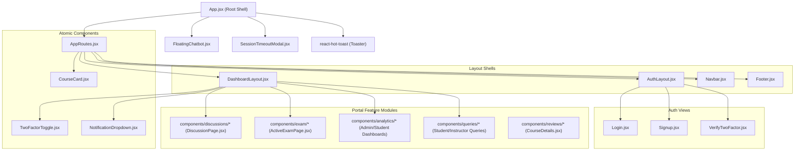

# SHNOOR LMS — UI Component Architecture & Design System

> **Document Version:** 1.0.0  
> **Target Audience:** Frontend Engineers, UI/UX Developers, Component Architects  
> **Status:** Production-Grade Documentation  
> **Source Directory:** [`src/components/`](../src/components/)  
> **Last Updated:** October 2026  

---

## 📑 Table of Contents

1. [UI Architecture & Directory Structure](#1-ui-architecture--directory-structure)
2. [Component Hierarchy & Structural Relationships](#2-component-hierarchy--structural-relationships)
3. [Component Relationship Diagram](#3-component-relationship-diagram)
4. [Shared Layouts & Shells](#4-shared-layouts--shells)
5. [Navigation & Header Components](#5-navigation--header-components)
6. [Card Components](#6-card-components)
7. [Dialogs, Modals & Drawers](#7-dialogs-modals--drawers)
8. [Interactive Assessment & Exam Suite](#8-interactive-assessment--exam-suite)
9. [Real-Time Discussions & Messaging Suite](#9-real-time-discussions--messaging-suite)
10. [Academic Support (Query System) Components](#10-academic-support-query-system-components)
11. [Review & Feedback System](#11-review--feedback-system)
12. [Analytics & Visualization Suite](#12-analytics--visualization-suite)
13. [Global Floating Chatbot Widget](#13-global-floating-chatbot-widget)
14. [Forms, Validation Patterns & Input Handling](#14-forms-validation-patterns--input-handling)
15. [Stateful States: Loading, Empty, Error & Disabled](#15-stateful-states-loading-empty-error--disabled)
16. [Responsive Design & Mobile-First Patterns](#16-responsive-design--mobile-first-patterns)
17. [Accessibility (A11y) & WCAG Compliance Standards](#17-accessibility-a11y--wcag-compliance-standards)
18. [Refactoring Candidates & Architectural Recommendations](#18-refactoring-candidates--architectural-recommendations)
19. [Master UI Component Reference Table](#19-master-ui-component-reference-table)

---

## 1. UI Architecture & Directory Structure

The UI layer is built upon a modular component architecture located in [`src/components/`](../src/components/):

```
src/components/
├── analytics/              # Recharts data visualizers and KPI metric cards
├── Chatbot/                # Conversational AI assistant widget and styles
├── discussions/            # Real-time discussion rooms, direct messaging, forwarding
├── exam/                   # Proctored exam timer, question navigator, podium
├── queries/                # Academic Q&A tickets, conversation thread viewer
├── reviews/                # Star ratings, review summaries, submission forms
├── AuthLayout.jsx          # Split-screen responsive layout for authentication
├── CourseCard.jsx          # Reusable course card (catalog, management, enrolled)
├── DashboardLayout.jsx     # Collapsible portal sidebar with theme selector & mobile drawer
├── ExportButton.jsx        # Data export button trigger (CSV, Excel, PDF)
├── FeatureCard.jsx         # Marketing feature highlight card
├── Footer.jsx              # Accessible platform footer with social links
├── LoadingScreen.jsx       # Branded full-screen loader
├── Navbar.jsx              # Responsive header navigation with glassmorphism
├── NotificationDropdown.jsx# Real-time notification popover
├── RouteLoadingFallback.jsx# Suspense skeleton fallback
├── SessionTimeoutModal.jsx # Inactivity watchdog prompt
└── TwoFactorToggle.jsx     # Reusable switch for email 2FA
```

---

## 2. Component Hierarchy & Structural Relationships

The UI components follow a strict visual hierarchy:
- **Root Shell** (`App.jsx`): Mounts global backdrop layers, toasts, `FloatingChatbot`, and `SessionTimeoutModal`.
- **Layout Shells** (`DashboardLayout.jsx`, `AuthLayout.jsx`): Wrap portal and authentication screens, managing layout constraints, sidebars, headers, and drawers.
- **Composite Domain Widgets** (e.g. `DiscussionPage`, `ActiveExamPage`, `CourseLearn`): Coordinate complex stateful sub-trees composed of specialized child components.
- **Atomic / Molecule Components** (e.g. `CourseCard`, `KPICard`, `OtpInput`, `StarRating`, `ExamTimer`): Stateless or semi-stateful reusable building blocks receiving data via props.

---

## 3. Component Relationship Diagram



---

## 4. Shared Layouts & Shells

### 4.1. `DashboardLayout.jsx`
- **Source**: [`src/components/DashboardLayout.jsx`](../src/components/DashboardLayout.jsx)
- **Props**:
  - `children`: Node (screen body).
  - `sidebarItems`: Array (optional custom items override).
  - `roleTitle`: String (`"ADMIN"`, `"MENTOR"`, `"STUDENT"`).
  - `pageTitle`: String (header display title).
- **Key Responsibilities**:
  - Renders the collapsible left sidebar (`w-20` collapsed vs. `w-64` expanded) with persistence in `localStorage('sidebarCollapsed')`.
  - Mounts the top sticky frosted header with dynamic page title, role badge, theme picker dropdown, notification bell (`NotificationDropdown`), and profile menu.
  - Implements mobile navigation with a slide-out drawer, body scroll lock, backdrop click dismissal, and `Escape` key handler.
  - Auto-selects active sidebar links using `useLocation().pathname`.

### 4.2. `AuthLayout.jsx`
- **Source**: [`src/components/AuthLayout.jsx`](../src/components/AuthLayout.jsx)
- **Props**:
  - `children`: Node (form content).
  - `title`: String (screen heading).
  - `subtitle`: String (explanatory text).
- **Key Responsibilities**:
  - Delivers a high-contrast dual-column split view (large branding & graphic banner on desktop; focused single column with brand mark on mobile).
  - Guarantees proper `<h1>` semantic document structure.

### 4.3. `Navbar.jsx` & `Footer.jsx`
- **`Navbar.jsx`**: Floating glassmorphism header for public screens with logo, category dropdown, theme selector, and login/dashboard action buttons.
- **`Footer.jsx`**: Standardized multi-column platform footer with explicit logo dimensions, category links, copyright notice, and accessible `aria-label` social links.

---

## 5. Navigation & Header Components

### 5.1. `NotificationDropdown.jsx`
- **Source**: [`src/components/NotificationDropdown.jsx`](../src/components/NotificationDropdown.jsx)
- **Functionality**:
  - Consumes `NotificationContext` (`notifications`, `unreadCount`, `markAsRead`, `markAllAsRead`).
  - Displays unread count badge on the bell icon.
  - Opens a popover menu showing timestamped notifications with icons corresponding to event type (`assignment`, `exam`, `query`, `discussion`).
  - Triggers pagination (`fetchNotifications(page + 1)`) via infinite scroll or load-more action.

### 5.2. `TwoFactorToggle.jsx`
- **Source**: [`src/components/TwoFactorToggle.jsx`](../src/components/TwoFactorToggle.jsx)
- **Functionality**:
  - Interactive switch toggle invoking `api.patch('/api/auth/2fa/toggle')`.
  - Displays instant visual feedback via `react-hot-toast` upon enabling or disabling email 2FA.

---

## 6. Card Components

| Component | Source Path | Key Props | Responsibilities & UI Features |
| :--- | :--- | :--- | :--- |
| **`CourseCard.jsx`** | [`src/components/CourseCard.jsx`](../src/components/CourseCard.jsx) | `course`, `isManagement`, `isEnrolled`, `onPublish`, `onDelete`, `onEdit` | Displays course thumbnail (with explicit dimensions and lazy loading), category badge, title, average star rating, duration, lecture count, and enrollment or management status pills. |
| **`KPICard.jsx`** | [`src/components/analytics/KPICard.jsx`](../src/components/analytics/KPICard.jsx) | `title`, `value`, `change`, `isPositive`, `icon`, `subtitle` | Metric summary card displaying key numbers, trend arrows (+/- percentage), and tinted icon backdrops. |
| **`QuizCard.jsx`** | [`src/components/QuizCard.jsx`](../src/components/QuizCard.jsx) | `quiz`, `courseTitle`, `onTake`, `onEdit`, `onDelete` | Displays quiz title, question count, time limit, passing percentage, and action buttons. |
| **`AssignmentCard.jsx`**| [`src/components/AssignmentCard.jsx`](../src/components/AssignmentCard.jsx) | `assignment`, `isInstructor`, `onSubmit`, `onGrade` | Displays assignment title, due date, submission count, status badge (Submitted, Graded, Pending), and attachment download triggers. |
| **`ExamCard.jsx`** | [`src/components/exam/ExamCard.jsx`](../src/components/exam/ExamCard.jsx) | `exam`, `onStart`, `onViewResult` | Exam tile showing total duration, total marks, scheduled start time, and status badge (`published`, `completed`, `active`). |
| **`CertificateCard.jsx`**| [`src/components/CertificateCard.jsx`](../src/components/CertificateCard.jsx)| `certificate`, `onDownload` | Displays issued certificate details, completion date, verified credential ID, and client-side PDF export button. |
| **`ReviewCard.jsx`** | [`src/components/reviews/ReviewCard.jsx`](../src/components/reviews/ReviewCard.jsx)| `review`, `isOwner`, `onEdit`, `onDelete` | Individual student review card showing user avatar, name, star rating, creation date, and qualitative commentary. |
| **`QueryCard.jsx`** | [`src/components/queries/QueryCard.jsx`](../src/components/queries/QueryCard.jsx) | `query`, `onClick`, `isInstructor` | Threaded Q&A ticket item showing query subject, course tag, status badge (`open`, `in-progress`, `resolved`), and reply count. |

---

## 7. Dialogs, Modals & Drawers

| Modal Component | Source Path | State Triggers | Behavior & User Workflow |
| :--- | :--- | :--- | :--- |
| **`ForwardMessageModal.jsx`** | [`src/components/discussions/ForwardMessageModal.jsx`](../src/components/discussions/ForwardMessageModal.jsx) | `isOpen`, `onClose`, `messageToForward` | WhatsApp-style message forwarding modal. Fetches destination course groups and direct contacts, allows multi-recipient selection, previews forwarded content, and executes `discussionService.forwardMessage()`. |
| **`DeleteMessageDialog.jsx`** | [`src/components/discussions/DeleteMessageDialog.jsx`](../src/components/discussions/DeleteMessageDialog.jsx) | `isOpen`, `onClose`, `onDeleteForMe`, `onDeleteForEveryone`, `canDeleteForEveryone` | Confirmation modal offering "Delete for Me" and "Delete for Everyone" options with ownership validation. |
| **`ClearDiscussionDialog.jsx`**| [`src/components/discussions/ClearDiscussionDialog.jsx`](../src/components/discussions/ClearDiscussionDialog.jsx)| `isOpen`, `onClose`, `onConfirm` | Warning dialog confirming irreversible clearing of discussion history. |
| **`ExamStartModal.jsx`** | [`src/components/exam/ExamStartModal.jsx`](../src/components/exam/ExamStartModal.jsx) | `isOpen`, `onClose`, `onConfirm`, `exam` | Pre-exam instructions modal detailing rules, camera monitoring notices, anti-cheat terms, and confirmation checkboxes. |
| **`ExamSubmitModal.jsx`** | [`src/components/exam/ExamSubmitModal.jsx`](../src/components/exam/ExamSubmitModal.jsx) | `isOpen`, `onClose`, `onSubmit`, `answeredCount`, `totalCount` | Confirmation prompt warning students of unanswered questions prior to final exam submission. |
| **`AIGenerateQuestionsModal.jsx`**| [`src/components/exam/AIGenerateQuestionsModal.jsx`](../src/components/exam/AIGenerateQuestionsModal.jsx)| `isOpen`, `onClose`, `onQuestionsGenerated` | Modal prompting instructor for topic keywords, question count, and difficulty level; calls backend AI service to generate multiple-choice questions. |
| **`AssignmentModal.jsx`** | [`src/components/AssignmentModal.jsx`](../src/components/AssignmentModal.jsx) | `isOpen`, `onClose`, `onSave`, `assignment` | Form dialog for creating/editing assignment title, description, due date, total points, and reference file attachment. |
| **`AssignmentSubmissionsModal.jsx`**| [`src/components/AssignmentSubmissionsModal.jsx`](../src/components/AssignmentSubmissionsModal.jsx)| `isOpen`, `onClose`, `assignmentId` | Instructor drawer listing student submissions with grading inputs and feedback text areas. |
| **`SessionTimeoutModal.jsx`**| [`src/components/SessionTimeoutModal.jsx`](../src/components/SessionTimeoutModal.jsx)| Inactivity timer | Global timeout modal warning of pending session expiration with "Stay Logged In" and "Logout" buttons. |

---

## 8. Interactive Assessment & Exam Suite

Located in [`src/components/exam/`](../src/components/exam/):

### 8.1. `ActiveExamPage.jsx` & Children
- **`ExamTimer.jsx`**: Real-time synchronized countdown clock. Dispatches critical alerts at 5 minutes and 1 minute remaining, and automatically fires `onTimeUp` to force-submit the exam upon timer expiration.
- **`QuestionNavigator.jsx`**: Interactive question grid allowing test-takers to jump directly to questions. Question buttons are dynamically color-coded:
  - *Green*: Answered
  - *Amber*: Marked for review
  - *Gray*: Unvisited / unanswered
- **Anti-Cheat Monitoring**:
  - Detects window blur and visibility changes (`visibilitychange` event).
  - Increments warning counter when tab-switching occurs; auto-submits upon exceeding threshold.
- **Answer Persistence**: Periodically syncs active answers to the backend (`api.put('/api/exam-attempts/:id/answers')`) to safeguard against accidental browser closures.

### 8.2. `LeaderboardPodium.jsx` & `LeaderboardTable.jsx`
- Renders gold, silver, and bronze podium finishers with avatars and score tags.
- Tabulates all student attempts with rank, completion time, score, and percentile calculation.

---

## 9. Real-Time Discussions & Messaging Suite

Located in [`src/components/discussions/`](../src/components/discussions/):

### 9.1. Architectural Layout
- **`DiscussionSidebar.jsx`**: Multi-tab switcher between Course Groups and Direct Contacts, including search input, unread count pills, and "New Direct Chat" triggers.
- **`DiscussionHeader.jsx`**: Displays room title, active member count, online presence avatars, search bar, and media/attachment panel toggles.
- **`MessageList.jsx`**: Virtualized/auto-scrolling message stream grouping messages by calendar date.

### 9.2. `MessageBubble.jsx`
- Distinguishes outgoing messages (aligned right, primary theme background) from incoming messages (aligned left, frosted card background).
- **Features**:
  - Sender name, avatar, and timestamp.
  - Three-dot contextual action menu (Delete for Me, Delete for Everyone, Forward Message).
  - Forwarded banner pill (`Forwarded` label with share icon).
  - Deleted message placeholder (`"This message was deleted"`).
  - Media rendering: images, audio, video, and documents (`FileMessage.jsx`).
  - Emoji reactions strip with counter pills.

### 9.3. `MessageComposer.jsx`
- Input text area with auto-grow behavior.
- Action buttons for file attachments (`AttachmentMenu.jsx`), sticker picker (`StickerPicker.jsx`), and emoji tray (`EmojiPicker.jsx`).
- Key binding: `Enter` to send; `Shift + Enter` for multi-line breaks.

---

## 10. Academic Support (Query System) Components

Located in [`src/components/queries/`](../src/components/queries/):
- **`QueryList.jsx`**: Filterable list of student inquiry tickets supporting status filtering (`All`, `Open`, `In-Progress`, `Resolved`).
- **`QueryConversation.jsx`**: Threaded conversation history between student and instructor, featuring status update dropdowns for instructors and rich-text message composition.
- **`CreateQueryModal.jsx`**: Student query creation form with course selection, title, description, and urgency indicator.

---

## 11. Review & Feedback System

Located in [`src/components/reviews/`](../src/components/reviews/):
- **`StarRating.jsx`**: Accessible, interactive 5-star rating selector supporting hover previews and readonly display.
- **`ReviewSummary.jsx`**: Visual breakdown displaying overall score (e.g. `4.8 / 5.0`), total reviews count, and five progress bars illustrating rating distributions (5-star down to 1-star).
- **`ReviewForm.jsx`**: Interactive form allowing enrolled students to post or update their ratings and feedback with character validation.

---

## 12. Analytics & Visualization Suite

Located in [`src/components/analytics/`](../src/components/analytics/):
- **`ActivityTrendChart.jsx`**: Recharts `<AreaChart>` / `<LineChart>` displaying daily study activity and video watch time across weekly or monthly ranges.
- **`CompletionDonutChart.jsx`**: Recharts `<PieChart>` visualizing course completion ratios (Completed vs. In-Progress vs. Not Started).
- **`CourseComparisonBarChart.jsx`**: Recharts `<BarChart>` comparing enrollments, revenue, and average quiz scores across authored courses.
- **`DateRangeFilter.jsx`**: Standardized range selector button group (`7 Days`, `30 Days`, `90 Days`, `All Time`).

---

## 13. Global Floating Chatbot Widget

Located in [`src/components/Chatbot/FloatingChatbot.jsx`](../src/components/Chatbot/FloatingChatbot.jsx):
- Fixed floating button docked at the bottom-right of the screen.
- Expands into an interactive AI conversational window.
- Communicates with `/api/chatbot/chat` to assist students with course queries, platform navigation, and technical troubleshooting.
- Features auto-scroll, typing status animations, and conversation clearing.

---

## 14. Forms, Validation Patterns & Input Handling

All form workflows implement structured validation and visual feedback:

| Form Component | Validation Rules | Error Presentation | Submit Flow |
| :--- | :--- | :--- | :--- |
| **`Login.jsx`** | Valid email format, password minimum 6 chars | Red focus borders, inline helper text, toast alerts | `firebaseAuth.service.login()` -> `api.get('/api/auth/me')` |
| **`Signup.jsx`** | Name required, matching passwords, admin token validation if role is Admin | Inline error labels beneath respective fields | `firebaseAuth.service.register()` -> `api.post('/api/auth/register-profile')` |
| **`ForgotPassword.jsx`** | Valid registered email address | Form validation alert, success message banner | `firebaseAuth.service.forgotPassword(email)` |
| **`VerifyTwoFactor.jsx`** | Exactly 6 numeric digits, auto-advance on input | Shaking animation on invalid code, toast error | `api.post('/api/auth/2fa/verify', { otp })` |
| **`ReviewForm.jsx`** | Star rating > 0, comment between 10 and 500 characters | Character counter, disabled submit button | `review.service.createCourseReview()` |

---

## 15. Stateful States: Loading, Empty, Error & Disabled

Components systematically provide comprehensive state feedback:
1. **Loading States**:
   - Route Suspense transitions: [`RouteLoadingFallback.jsx`](../src/components/RouteLoadingFallback.jsx).
   - Component data fetching: Skeleton pulsing shapes or centered `<Loader />` spinners.
   - Form submission: Submit buttons render animated spinner icons and toggle `disabled={loading}`.
2. **Empty States**:
   - `DiscussionPage`: Shows centered illustration with `"Select a conversation to start chatting"`.
   - `CourseList`: Shows `"No courses found matching your criteria"` with a `"Clear Filters"` button.
   - `StudentMyCourses`: Prompts with `"You haven't enrolled in any courses yet"` and a link to the catalog.
3. **Error Boundaries & Feedback**:
   - Network failure toasts dispatched through `react-hot-toast`.
   - Inline alert badges (`AlertCircle` icon) with retry triggers.

---

## 16. Responsive Design & Mobile-First Patterns

The application conforms to standard mobile/tablet/desktop breakpoints:
- **Mobile (`< 768px`)**:
  - Dual-column layouts collapse to single-column vertical flows.
  - Sidebar collapses into an off-screen drawer toggled by a hamburger menu.
  - Tap targets adhere to a minimum dimension of 44x44px.
  - Video players scale to `100%` viewport width.
- **Tablet (`768px - 1024px`)**:
  - Grid displays transition to two columns (e.g. course catalogs, KPI cards).
  - Discussion list and chat pane switch to adaptive split layout.
- **Desktop (`> 1024px`)**:
  - Full three-column or dual-pane workspaces.
  - Persistent sidebar navigation with toggleable icon-only rail collapse (`w-20`).

---

## 17. Accessibility (A11y) & WCAG Compliance Standards

The UI components implement the following accessibility practices:
1. **Semantic HTML**: Proper use of `<header>`, `<main>`, `<aside>`, `<nav>`, `<footer>`, and hierarchical heading structures (`<h1>` through `<h4>`).
2. **Form Controls**: All inputs are explicitly paired with `<label htmlFor="id">` and `<input id="id">`. Password toggles and clear buttons provide explicit `aria-label` attributes.
3. **Keyboard Interactivity**:
   - `Escape` key dismisses mobile drawers and modals (`DashboardLayout.jsx`).
   - Modal focus trapping and focus ring utilities (`focus:ring-2 focus:ring-indigo-500`).
4. **Color Contrast**: Complies with WCAG 2.1 AA standards (minimum 4.5:1 contrast ratio for body text against dark, light, cream, and eco backgrounds).
5. **Screen Reader Hints**: Decorative icons include `aria-hidden="true"`; interactive icon buttons include `aria-label` or visually hidden text.

---

## 18. Refactoring Candidates & Architectural Recommendations

1. **Modal Architecture Standardization**: Modals currently implement custom backdrop overlays individually.  
   *Recommendation:* Extract a shared `<ModalBase isOpen={isOpen} onClose={onClose} title={title}>` container with standardized backdrop blur and accessibility focus trap.
2. **Form State Management**: Forms currently rely on isolated `useState` hooks.  
   *Recommendation:* Introduce `react-hook-form` with `zod` schema validation for complex forms such as `CreateCourse` and `QuestionEditorModal`.
3. **Discussion Component Decomposition**: `DiscussionPage.jsx` is large (~1,000 lines). Sub-features (media upload, room selection, forward coordination) can be further decoupled into dedicated custom hooks (`useDiscussionChat`, `useDirectChat`).

---

## 19. Master UI Component Reference Table

| Component Name | Relative File Path | Primary Responsibility | Dependencies | Reuse Status |
| :--- | :--- | :--- | :--- | :--- |
| `DashboardLayout` | [`src/components/DashboardLayout.jsx`](../src/components/DashboardLayout.jsx) | Portal shell with collapsible sidebar & theme switch | `lucide-react`, `AuthContext`, `ThemeContext` | High (All Portals) |
| `AuthLayout` | [`src/components/AuthLayout.jsx`](../src/components/AuthLayout.jsx) | Responsive dual-column shell for auth forms | None | High (All Auth Views)|
| `Navbar` | [`src/components/Navbar.jsx`](../src/components/Navbar.jsx) | Public marketing navigation header | `lucide-react`, `AuthContext`, `ThemeContext` | High (Public Pages) |
| `Footer` | [`src/components/Footer.jsx`](../src/components/Footer.jsx) | Public marketing footer with social links | `lucide-react` | High (Public Pages) |
| `CourseCard` | [`src/components/CourseCard.jsx`](../src/components/CourseCard.jsx) | Universal course display card | `lucide-react`, `AuthContext` | High (Catalogs, Portals)|
| `KPICard` | [`src/components/analytics/KPICard.jsx`](../src/components/analytics/KPICard.jsx) | Metric display card with trends | `lucide-react` | High (All Dashboards)|
| `NotificationDropdown` | [`src/components/NotificationDropdown.jsx`](../src/components/NotificationDropdown.jsx) | Popover menu for live notifications | `NotificationContext` | High (DashboardLayout)|
| `TwoFactorToggle` | [`src/components/TwoFactorToggle.jsx`](../src/components/TwoFactorToggle.jsx) | Interactive 2FA switch | `api.service`, `react-hot-toast` | High (Profile Views)|
| `SessionTimeoutModal` | [`src/components/SessionTimeoutModal.jsx`](../src/components/SessionTimeoutModal.jsx) | Inactivity watchdog prompt | `AuthContext` | Global Singleton |
| `FloatingChatbot` | [`src/components/Chatbot/FloatingChatbot.jsx`](../src/components/Chatbot/FloatingChatbot.jsx) | Expandable conversational AI assistant | `chatbot.service`, `lucide-react` | Global Singleton |
| `ForwardMessageModal` | [`src/components/discussions/ForwardMessageModal.jsx`](../src/components/discussions/ForwardMessageModal.jsx) | Cross-group message forwarding dialog | `discussion.service`, `directChat.service` | High (Discussions) |
| `DeleteMessageDialog` | [`src/components/discussions/DeleteMessageDialog.jsx`](../src/components/discussions/DeleteMessageDialog.jsx) | Message deletion confirmation modal | `lucide-react` | High (Discussions) |
| `ExamTimer` | [`src/components/exam/ExamTimer.jsx`](../src/components/exam/ExamTimer.jsx) | Countdown exam timer with alerts | `lucide-react` | Active Exam |
| `QuestionNavigator` | [`src/components/exam/QuestionNavigator.jsx`](../src/components/exam/QuestionNavigator.jsx) | Exam question status grid | None | Active Exam |
| `StarRating` | [`src/components/reviews/StarRating.jsx`](../src/components/reviews/StarRating.jsx) | Interactive and readonly star rating | `lucide-react` | High (Reviews, Cards)|
| `ReviewSummary` | [`src/components/reviews/ReviewSummary.jsx`](../src/components/reviews/ReviewSummary.jsx) | Aggregate review score and bar charts | None | Course Details |
| `QueryConversation` | [`src/components/queries/QueryConversation.jsx`](../src/components/queries/QueryConversation.jsx)| Threaded Q&A ticket conversation view | `courseQuery.service` | High (Query Portals)|
| `ActivityTrendChart` | [`src/components/analytics/ActivityTrendChart.jsx`](../src/components/analytics/ActivityTrendChart.jsx)| Recharts study trend visualizer | `recharts` | Dashboards |
| `RouteLoadingFallback`| [`src/components/RouteLoadingFallback.jsx`](../src/components/RouteLoadingFallback.jsx)| Suspense route transition skeleton | None | Global Router |
