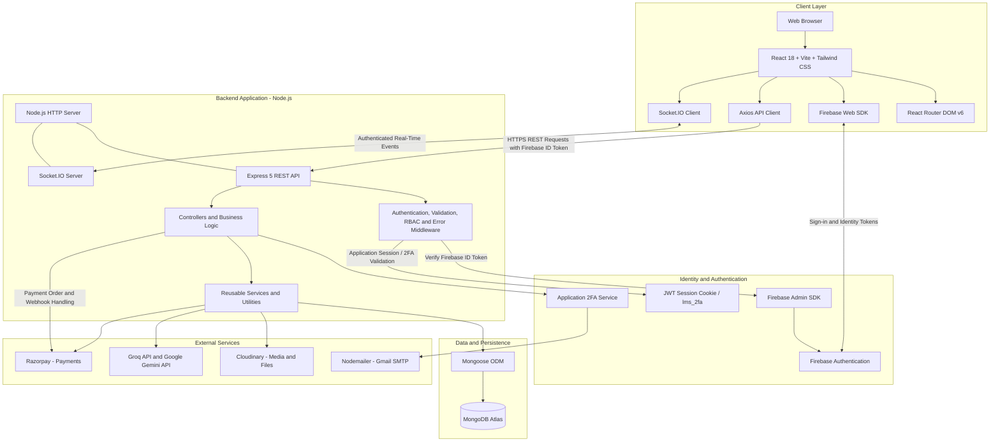

# LMS Platform - Next-Generation Learning Management System

A full-stack, enterprise-grade Learning Management System (LMS) built with **React 18**, **Vite**, **Node.js**, **Express**, **MongoDB**, and **Firebase Authentication**. Features role-based workspaces for Students, Instructors, and Administrators, real-time Socket.io communication, AI-assisted learning (Groq & Gemini), anti-cheat exam engine, 2FA security, and automated verified certificate generation.

---

## 📑 Table of Contents

- [System Architecture](#-system-architecture)
- [Key Features](#-key-features)
- [Tech Stack](#-tech-stack)
- [User Roles & Portals](#-user-roles--portals)
- [Directory Structure](#-directory-structure)
- [API Endpoints Overview](#-api-endpoints-overview)
- [Environment Configuration](#-environment-configuration)
- [Setup & Installation](#-setup--installation)
- [Development & Scripts](#-development--scripts)
- [Security & Authentication](#-security--authentication)

---

## 🏛 System Architecture

The LMS follows a **client-server architecture with a modular backend and managed external services**. The React frontend handles presentation and client-side navigation, while the Express backend owns business logic, authorization, validation, database access, and integrations with external services.

Firebase Authentication manages identity authentication. The backend verifies Firebase ID tokens through the Firebase Admin SDK and applies application-level authorization. MongoDB Atlas persists application data, while Cloudinary, Nodemailer, AI providers, and Razorpay provide external capabilities.

Socket.IO is integrated with the Node.js HTTP server to support real-time messaging and notifications alongside the REST API.

### High-Level Architecture Diagram



### Architecture Responsibilities

| Layer | Responsibility |
|---|---|
| Presentation | React components, responsive UI, role-based navigation, dashboards and learning interfaces. |
| Client Authentication | Firebase Web SDK sign-in flows and retrieval of Firebase ID tokens. |
| API Communication | Axios sends requests to the backend with the required authentication credentials. |
| API and Business Logic | Express routes, controllers, reusable services, validation and application workflows. |
| Authentication and Authorization | Firebase ID token verification, application session validation where required, RBAC and resource-level access checks. |
| Real-Time Communication | Socket.IO manages authenticated connections, direct messaging, typing status and live notifications. |
| Data Persistence | Mongoose models and MongoDB Atlas collections store users, courses, assessments, progress, messages, certificates and related records. |
| File and Media Storage | Cloudinary stores supported uploaded assets and documents; the database stores relevant metadata and references. |
| Email Delivery | Nodemailer connects to Gmail SMTP for OTP delivery and supported email notifications. |
| AI Integration | Groq and Gemini APIs support the chatbot and AI-assisted question generation. |
| Payments | Razorpay handles payment orders and payment verification through server-side processing and verified webhooks. |

### Request and Data Flow

1. **Authentication:** Users sign in through Firebase Authentication. The frontend obtains a Firebase ID token and sends it to the backend for verification.
2. **Authorization:** The backend verifies the identity token and checks application-level roles, permissions, resource ownership and any additional session requirements.
3. **Business Operations:** Express routes pass validated requests to controllers and services, which perform the required operations.
4. **Persistence:** Mongoose interacts with MongoDB Atlas to create, read, update or delete application records.
5. **File Uploads:** The backend validates uploads and coordinates storage with Cloudinary. Database records retain the associated file metadata and references.
6. **Real-Time Events:** The Socket.IO client connects to the Socket.IO server attached to the Node.js HTTP server. The server authenticates connections and authorizes room membership and individual events.
7. **External Integrations:** Backend services call the configured email, AI and payment providers. Credentials remain server-side.
8. **Payment Verification:** The backend verifies payment responses and webhook signatures before treating a payment as successful or granting paid-course access.

### Important Architecture Notes

- Firebase Authentication and the LMS application's 2FA/session mechanism have separate responsibilities. Firebase ID tokens establish the user's Firebase identity; any additional application session or 2FA requirement must be enforced explicitly by the backend.
- An `httpOnly` cookie cannot be read directly by frontend JavaScript. Cookie-based authentication requires the correct credentialed request configuration and server-side cookie validation. If both bearer tokens and cookies are supported, their responsibilities and precedence must be explicit.
- Socket.IO connections require authentication and authorization independently of protected REST endpoints. Joining a room or sending an event must not be permitted solely because a client supplies a user ID or room name.
- Razorpay payment success must be determined by trusted server-side verification, not solely by frontend checkout callbacks.
- AI providers, email delivery and other external dependencies should use bounded timeouts, appropriate error handling and controlled retries. Optional integrations should not prevent the HTTP server from starting unless the application explicitly requires them.
- MongoDB indexes, database constraints, pagination, input validation and appropriate authorization checks are required to maintain data integrity and predictable performance.
- This is a logical architecture diagram. Actual deployment topology, scaling strategy, background jobs, caching, monitoring and production high availability depend on the implemented infrastructure.

---

## ✨ Key Features

### 🔐 1. Authentication & Security

- **Firebase Auth Integration**: Email/Password, Google OAuth popup, and GitHub OAuth sign-in.
- **Auto-Provisioning**: Google sign-in on login automatically provisions a default `Student` profile if new, or navigates straight to role-based dashboard.
- **Two-Factor Authentication (2FA)**: Time-limited 6-digit email OTP with rate-limiting, resend cooldown, and secure `httpOnly` JWT session cookies (`lms_2fa`).
- **Role-Based Access Control (RBAC)**: Strict route and controller protections for `Student`, `Instructor`, and `Admin`.

### 📚 2. Course Management & Delivery

- **Modular Curriculum**: Course creation with chapters, video lessons, downloadable resources, and assignment attachments.
- **Student Learning View**: Smooth video playback, completion tracking, downloadable files, and lecture notes.
- **Reviews & Ratings**: Students rate and review courses with aggregated stars and feedback.

### 📝 3. Assessment, Quiz & Anti-Cheat Exam Engine

- **Quizzes**: Timed interactive quizzes with immediate feedback, explanations, and attempts tracking.
- **AI-Powered Question Generator**: Instructors can auto-generate multiple-choice and conceptual questions using Groq/Gemini.
- **Anti-Cheat Examinations**: Proctored active exam interface with camera preview permission, tab-switch event tracking, countdown timer, auto-submission on expiration, and dynamic leaderboard rankings.
- **Assignments**: File attachments (PDF/ZIP/docs), deadline validation, student submissions, and instructor grading with marks and feedback.

### 💬 4. Real-Time Collaboration & Discussion

- **Socket.io Direct Messaging**: Live 1-on-1 conversations between students and instructors with unread counts and typing status.
- **Discussion Forums**: Course-level public discussion threads and replies.
- **Course Queries**: Dedicated student-to-instructor Q&A ticket desk with status updates (`Pending`, `Answered`, `Resolved`).
- **Live Notifications**: Real-time push alerts for assignment grading, quiz releases, query answers, and course announcements.

### 🎓 5. Verified Digital Certificates

- **Automated Generation**: Instant digital certificate creation upon 100% course completion.
- **Public Verification**: Unique certificate codes with public verification endpoint (`/api/certificates/verify/:id`).
- **PDF Export**: Download high-resolution verified PDF certificates powered by HTML2Canvas & jsPDF.

### 🤖 6. AI Learning Assistant & Chatbot

- **Interactive Tutor**: AI Chatbot available across the app powered by Groq LLaMA models and Google Gemini.
- **Admin Chatbot Logs**: Full administrative audit trail of chatbot inquiries and performance metrics.

### 📊 7. Analytics & Export Engine

- **Visual Analytics**: Interactive KPI charts for enrollment metrics, revenue, completion rates, and cohort benchmarks.
- **Report Exports**: Export platform metrics, user logs, and course performance to CSV and PDF.

---

## 🛠 Tech Stack

### Frontend

| Technology | Description |
|---|---|
| **React 18** | UI framework with Hooks and Context API |
| **Vite** | Next-generation build tool & dev server |
| **Tailwind CSS** | Utility-first styling with modern dark glass design tokens |
| **React Router DOM v6** | Client-side routing with protected role gates |
| **Lucide React** | Modern icon set |
| **Axios** | HTTP client with automatic Firebase token injection |
| **Firebase Web SDK** | Client-side authentication |
| **Socket.io Client** | Real-time WebSocket connection |
| **HTML2Canvas & jsPDF** | Client-side PDF generation for certificates |

### Backend

| Technology | Description |
|---|---|
| **Node.js (v20+)** | Runtime environment |
| **Express 5** | REST API framework |
| **MongoDB & Mongoose 9** | NoSQL database & ODM |
| **Firebase Admin SDK** | Server-side token verification & user management |
| **Socket.io** | WebSocket server for real-time messaging & alerts |
| **Cloudinary** | Cloud storage for course assets, videos, avatars & attachments |
| **Nodemailer** | Gmail SMTP transport for 2FA OTP codes and email alerts |
| **Groq SDK & Gemini API** | AI LLM integration for chatbot and test question creation |
| **Razorpay** | Payment processing for premium courses |
| **JWT & Cookie-Parser** | Secure cookie session management for 2FA |
| **Multer** | Multipart form-data file uploads |

---

## 👥 User Roles & Portals

### 🎓 Student Workspace

- **Personalized Learner Portal**: Enrolled courses overview, progress trackers, and recent activity timeline.
- **My Courses & Learn**: Chapter-by-chapter curriculum, video lectures, and lecture notes.
- **Quiz & Exam Center**: Take timed quizzes, view anti-cheat exam instructions, take active exams, and view leaderboards.
- **Practice Zone**: Interactive coding challenges and problem-solving exercises.
- **Certificates**: View, share, and download verified certificates for completed courses.
- **Student Queries**: Submit questions directly to instructors for enrolled courses.

### 👨‍🏫 Instructor Workspace

- **Instructor Cohort Hub**: Real-time cohort health metrics, learners requiring attention, and active courses.
- **Course Studio**: Create, edit, and organize courses with rich descriptions, pricing, and curriculum modules.
- **Quiz & Exam Studio**: Create quizzes manually or auto-generate questions with AI.
- **Assignment Evaluation**: View submissions, preview answer files, assign grades, and leave feedback.
- **Instructor Queries & Discussions**: Answer student questions and participate in community threads.

### ⚙️ Administrator Workspace

- **Command Center**: Platform-wide operational health, revenue figures, draft courses, and user metrics.
- **User Management**: View all users, search, filter by role, activate/suspend accounts, or update permissions.
- **Course Oversight**: Review draft courses, publish/unpublish, approve instructor content, and manage categories.
- **Chatbot & Audit Logs**: Review AI chatbot logs, system inquiries, and error traces.
- **Exports & Analytics**: Export detailed platform reports to CSV and PDF.

---

## 📂 Directory Structure

```text
SHNOOR/LMS/
├── BACKEND/
│   ├── Configs/                # Database, Firebase Admin, Passport, Socket setups
│   │   ├── db.js
│   │   ├── firebaseAdmin.js
│   │   ├── passport.js
│   │   └── socket.js
│   ├── Controllers/            # Route handler business logic
│   │   ├── admin.controller.js
│   │   ├── analytics.controller.js
│   │   ├── assignment.controller.js
│   │   ├── assignmentSubmission.controller.js
│   │   ├── auth.controller.js
│   │   ├── category.controller.js
│   │   ├── certificate.controller.js
│   │   ├── chatbot.controller.js
│   │   ├── content.controller.js
│   │   ├── course.controller.js
│   │   ├── courseQuery.controller.js
│   │   ├── courseReview.controller.js
│   │   ├── discussion.controller.js
│   │   ├── exam.controller.js
│   │   ├── examAttempt.controller.js
│   │   ├── examQuestion.controller.js
│   │   ├── export.controller.js
│   │   ├── instructor.controller.js
│   │   ├── message.controller.js
│   │   ├── notification.controller.js
│   │   ├── practice.controller.js
│   │   ├── progress.controller.js
│   │   ├── quiz.controller.js
│   │   ├── quizQuestion.controller.js
│   │   ├── report.controller.js
│   │   ├── resource.controller.js
│   │   └── student.controller.js
│   ├── Helpers/                # OTP generators, calculation helpers
│   ├── Middlewares/            # Authentication, role verification, uploads
│   │   ├── auth.middleware.js
│   │   ├── role.middleware.js
│   │   ├── upload.middleware.js
│   │   └── profileUpload.middleware.js
│   ├── Models/                 # Mongoose schemas
│   │   ├── User.model.js
│   │   ├── StudentProfile.model.js
│   │   ├── InstructorProfile.model.js
│   │   ├── Course.model.js
│   │   ├── Content.model.js
│   │   ├── Assignment.model.js
│   │   ├── AssignmentSubmission.model.js
│   │   ├── Quiz.model.js
│   │   ├── Exam.model.js
│   │   ├── Certificate.model.js
│   │   └── ...
│   ├── Routes/                 # Express router definitions
│   │   ├── auth.routes.js
│   │   ├── course.route.js
│   │   ├── student.route.js
│   │   ├── instructor.route.js
│   │   ├── admin.route.js
│   │   └── ...
│   ├── Utils/                  # Nodemailer, Cloudinary uploaders, mail templates
│   ├── .env                    # Backend environment config (not committed)
│   ├── package.json
│   └── server.js               # Entry point, Express app & Socket.io server
│
├── FRONTEND/
│   ├── src/
│   │   ├── components/         # Reusable UI components & modals
│   │   │   ├── LoadingScreen.jsx       # Interactive orbital pulse loader
│   │   │   ├── Navbar.jsx              # Top navigation with role links
│   │   │   ├── DashboardLayout.jsx     # Sidebar and dashboard wrapper
│   │   │   ├── GoogleAuthButton.jsx    # Social login button
│   │   │   ├── SessionTimeoutModal.jsx # Session inactivity warning
│   │   │   └── ...
│   │   ├── context/            # React context providers
│   │   │   ├── AuthContext.jsx        # Auth state, fast /me sync, 2FA
│   │   │   ├── NotificationContext.jsx
│   │   │   └── ThemeContext.jsx
│   │   ├── pages/              # Route views
│   │   │   ├── LandingPage.jsx
│   │   │   ├── Login.jsx
│   │   │   ├── Signup.jsx
│   │   │   ├── VerifyTwoFactor.jsx
│   │   │   ├── CourseDetails.jsx
│   │   │   ├── dashboards/
│   │   │   │   ├── StudentDashboard.jsx
│   │   │   │   ├── InstructorDashboard.jsx
│   │   │   │   ├── AdminDashboard.jsx
│   │   │   │   └── ...
│   │   ├── routes/             # AppRoutes with role-based ProtectedRoute
│   │   │   └── AppRoutes.jsx
│   │   ├── services/           # Axios API service, Firebase auth service
│   │   │   ├── api.service.js
│   │   │   └── firebaseAuth.service.js
│   │   ├── styles/             # Tailwind & theme variables
│   │   │   ├── theme.css       # Obsidian & midnight glass color tokens
│   │   │   └── index.css       # Global styles, smooth scroll & scrollbars
│   │   └── utils/              # Helper functions & route paths
│   ├── .env                    # Frontend environment config (not committed)
│   ├── index.html
│   └── vite.config.js
└── README.md                   # Project documentation
```

---

## 🔌 API Endpoints Overview

### Authentication (`/api/auth`)

| Method | Endpoint | Description | Access |
|---|---|---|---|
| `POST` | `/register` | Register new user profile in MongoDB | Public (Firebase Bearer) |
| `GET` | `/me` | Get current authenticated user profile & role | Authenticated (2FA verified where required) |
| `POST` | `/2fa/check` | Check 2FA requirement and send OTP | Authenticated (Bearer) |
| `POST` | `/2fa/verify` | Verify 6-digit 2FA OTP and issue session cookie | Authenticated (Bearer) |
| `POST` | `/2fa/resend` | Resend new 2FA OTP code | Authenticated (Bearer) |
| `POST` | `/2fa/enable` | Enable two-factor authentication on account | Authenticated |
| `POST` | `/2fa/disable` | Disable two-factor authentication | Authenticated |
| `POST` | `/logout` | Invalidate user session & clear cookies | Authenticated |

### Courses (`/api/courses`)

| Method | Endpoint | Description | Access |
|---|---|---|---|
| `GET` | `/` | Get all published courses | Public |
| `GET` | `/:id` | Get single course details by ID | Public / Enrolled, depending on the fields requested |
| `POST` | `/` | Create new course | Instructor, Admin |
| `PUT` | `/:id` | Edit course information & thumbnail | Instructor, Admin, subject to ownership/permissions |
| `DELETE` | `/:id` | Delete course | Instructor, Admin, subject to ownership/permissions |
| `POST` | `/:id/enroll` | Enroll student in course | Student |

### Assignments (`/api/assignment`)

| Method | Endpoint | Description | Access |
|---|---|---|---|
| `GET` | `/course/:courseId` | Get assignments for course | Authenticated, with course-level access checks |
| `POST` | `/course/:courseId` | Create new assignment | Instructor, Admin |
| `PUT` | `/:assignmentId` | Edit assignment details | Instructor, Admin |
| `DELETE` | `/:assignmentId` | Delete assignment | Instructor, Admin |
| `POST` | `/:assignmentId/submit` | Student file submission | Student |
| `GET` | `/:assignmentId/submissions` | View all submissions | Instructor, Admin |
| `PATCH` | `/submissions/:submissionId/evaluate` | Grade & evaluate submission | Instructor, Admin |

### Quizzes & Exams (`/api/quizzes`, `/api/exams`)

| Method | Endpoint | Description | Access |
|---|---|---|---|
| `GET` | `/api/quizzes/course/:courseId` | Get quizzes for course | Authenticated |
| `POST` | `/api/quizzes` | Create new quiz | Instructor, Admin |
| `POST` | `/api/quizzes/:id/submit` | Submit quiz attempt & score | Student |
| `GET` | `/api/exams` | Get available exams | Authenticated |
| `POST` | `/api/exams/:id/start` | Start timed exam attempt | Student |
| `POST` | `/api/exams/:id/submit` | Submit exam answers | Student |
| `GET` | `/api/exams/:id/leaderboard` | View exam leaderboard | Authenticated |

### Certificates (`/api/certificates`)

| Method | Endpoint | Description | Access |
|---|---|---|---|
| `GET` | `/my-certificates` | Get all earned certificates | Student |
| `POST` | `/generate/:courseId` | Generate course completion certificate | Student |
| `GET` | `/verify/:code` | Public certificate verification | Public |

### AI Assistant & Chatbot (`/api/chatbot`)

| Method | Endpoint | Description | Access |
|---|---|---|---|
| `POST` | `/ask` | Ask AI chatbot tutor for help | Authenticated |
| `GET` | `/logs` | View chatbot usage logs and analytics | Admin |

> **Note:** This endpoint overview documents the intended API surface. Actual route prefixes and permissions must match the mounted Express routers and middleware in the source code.

---

## ⚙️ Environment Configuration

### Backend (`BACKEND/.env`)

Create a `.env` file in the `BACKEND/` directory with the following variables:

```env
# Server Configuration
PORT=5000
NODE_ENV=development
CLIENT_URL=http://localhost:5173

# Database
MONGO_URI=mongodb+srv://<username>:<password>@cluster0.mongodb.net/lms?retryWrites=true&w=majority

# Security & Secrets
JWT_SECRET=your_super_secret_jwt_key
SESSION_SECRET=your_session_secret_key
TWO_FACTOR_OTP_SECRET=your_hmac_sha256_otp_secret_key
LMS_2FA_SESSION_SECRET=your_2fa_session_jwt_secret_key
ADMIN_ACCESS_TOKEN=your_admin_registration_passcode

# Firebase Admin SDK
# Configure the service account using the mechanism supported by your backend.
# Prefer a securely supplied service-account JSON or individual environment variables.
FIREBASE_PROJECT_ID=your_firebase_project_id
FIREBASE_CLIENT_EMAIL=your_firebase_service_account_email
FIREBASE_PRIVATE_KEY="your_firebase_private_key"

# Cloudinary (Media & Files)
CLOUDINARY_CLOUD_NAME=your_cloudinary_cloud_name
CLOUDINARY_API_KEY=your_cloudinary_api_key
CLOUDINARY_API_SECRET=your_cloudinary_api_secret

# Email Service (Nodemailer Gmail SMTP)
EMAIL_USER=your_email@gmail.com
EMAIL_PASS=your_gmail_app_password

# AI Integrations
GROQ_API_KEY=your_groq_api_key
GROQ_MODEL=openai/gpt-oss-120b
GEMINI_API_KEY=your_gemini_api_key

# Payment Gateway (Optional / Razorpay)
RAZORPAY_KEY_ID=your_razorpay_key_id
RAZORPAY_KEY_SECRET=your_razorpay_key_secret
```

**Environment configuration notes:**

- Use real credentials only in local environment files or your hosting provider's secret manager. Do not commit `.env` files to Git.
- The Firebase Admin variable names above are examples. Match them to the initialization code in `BACKEND/Configs/firebaseAdmin.js`. If the application uses a service-account JSON environment variable or another supported configuration, preserve that implementation.
- When using `FIREBASE_PRIVATE_KEY` as an environment variable, handle escaped newline characters appropriately in the initialization code.
- For Gmail SMTP, use an App Password when required by the Google account's security configuration.
- SMTP verification should use a bounded timeout and should not indefinitely block startup when email delivery is an optional service.
- Keep payment and AI secrets exclusively on the backend.

### Frontend (`FRONTEND/.env`)

Create a `.env` file in the `FRONTEND/` directory with the following variables:

```env
# Backend API Base URL
VITE_API_BASE_URL=http://localhost:5000

# Firebase Client SDK Configuration
VITE_FIREBASE_API_KEY=AIzaSy...
VITE_FIREBASE_AUTH_DOMAIN=your-project.firebaseapp.com
VITE_FIREBASE_PROJECT_ID=your-project
VITE_FIREBASE_STORAGE_BUCKET=your-project.firebasestorage.app
VITE_FIREBASE_MESSAGING_SENDER_ID=your_sender_id
VITE_FIREBASE_APP_ID=1:your_app_id
VITE_FIREBASE_MEASUREMENT_ID=G-XXXXX
```

> Variables prefixed with `VITE_` are included in the client-side build and must not contain server-side secrets. Firebase web configuration is intended for client-side use; protect the application with appropriate Firebase security rules, backend authorization, and API restrictions.

---

## 🚀 Setup & Installation

### Prerequisites

- **Node.js**: v20 or higher recommended for the documented backend stack.
- **npm**: v9.0.0 or higher.
- **MongoDB**: Local MongoDB instance or MongoDB Atlas cluster.
- **Firebase Account**: Firebase project with Authentication providers enabled, including Email/Password and the required social providers.
- **External Service Accounts**: Cloudinary, Gmail SMTP, and optional Groq, Gemini, and Razorpay credentials as required by the features being used.

### Step 1: Clone Repository

```bash
git clone https://github.com/Animesh-Samantaray/LMS.git
cd LMS
```

### Step 2: Install Backend Dependencies

```bash
cd BACKEND
npm install
```

### Step 3: Install Frontend Dependencies

```bash
cd ../FRONTEND
npm install
```

### Step 4: Configure Environment Files

Set up both `BACKEND/.env` and `FRONTEND/.env` as detailed in the [Environment Configuration](#-environment-configuration) section.

Ensure that the backend environment loader runs before modules that depend on environment variables are initialized.

### Step 5: Start Development Servers

**Terminal 1 — Backend:**

```bash
cd BACKEND
npm run dev
```

The backend listens on the configured port, typically `http://localhost:5000`.

**Terminal 2 — Frontend:**

```bash
cd FRONTEND
npm run dev
```

Vite typically starts at `http://localhost:5173`.

Open your browser and navigate to `http://localhost:5173`.

---

## 📦 Production Build

To build the frontend for production:

```bash
cd FRONTEND
npm run build
```

The optimized bundle will be created in `FRONTEND/dist`.

To test the production build locally:

```bash
npm run preview
```

Run the preview command from `FRONTEND/` after building the frontend.

For deployment, configure the frontend and backend separately as appropriate for your hosting provider. Set production API URLs, allowed frontend origins, environment secrets, Firebase configuration, database access and any external integration settings required by the application.

---

## 🔒 Security & Best Practices

1. **Token Authentication**: Protected API endpoints must verify Firebase ID tokens through the server-side Firebase Admin SDK. Token verification establishes identity; authorization checks must still enforce roles, permissions, account status and resource ownership.
2. **Two-Factor Authentication (2FA)**: High-security accounts can toggle 2FA. The backend generates HMAC-SHA256-protected OTP values valid for 10 minutes with strict cooldown and attempt thresholds. Store OTP-related secrets securely and prevent replay, brute-force attempts and unauthorized resend requests.
3. **Session Management**: `httpOnly` cookies reduce direct JavaScript access to session tokens, but do not by themselves prevent CSRF or guarantee that a session has completed 2FA. Validate cookie signatures, expiration, issuer and audience where applicable. Configure `Secure`, `SameSite`, credentialed CORS and CSRF protections according to the deployment topology.
4. **CORS & Cookies**: Configure an explicit allowlist of trusted frontend origins. Use `credentials: true` only where required and ensure the client and server agree on the authentication mechanism. Do not use wildcard origins with credentialed requests.
5. **Input Validation & Sanitization**: Request bodies, names and emails should be normalized, trimmed and validated before database persistence. Validate ObjectIds, file types, upload sizes, pagination limits and query parameters. Use safe database queries and avoid trusting client-supplied role, price or ownership fields.
6. **Role-Based and Resource-Level Authorization**: Enforce authorization in backend middleware and controllers, not just in frontend route guards. Verify course ownership, enrollment status, submission ownership, instructor permissions and administrator privileges for every protected operation.
7. **Socket.IO Security**: Authenticate each socket connection and authorize room membership and individual events. Validate message payloads, enforce rate limits and avoid exposing private messages or notifications to unauthorized users.
8. **Payment Security**: Verify Razorpay signatures on the backend and validate webhook signatures against the raw request body where required. Make payment processing idempotent and do not grant paid-course access based solely on frontend success callbacks.
9. **File Upload Security**: Validate file types and sizes, restrict upload permissions, handle filenames safely and keep credentials server-side. Ensure private course materials and assignment submissions cannot be accessed through unauthorized public URLs.
10. **External Service Resilience**: Configure timeouts, safe error handling and bounded retries for SMTP, AI and payment integrations. Optional services should not prevent application startup unless they are mandatory dependencies.
11. **Database Reliability**: Use appropriate indexes, schema validation, unique constraints, pagination and atomic updates where needed. Configure MongoDB connection errors and shutdown handling so failed database connectivity is observable and managed safely.
12. **Logging and Monitoring**: Record actionable operational events without logging passwords, secrets, session tokens, OTP values, private message content or other sensitive information. Use centralized error handling and health checks that distinguish process availability from dependency readiness.
13. **Secrets and Environment Management**: Keep all server-side credentials out of source control and frontend environment variables. Rotate exposed credentials, use separate development and production secrets, and validate required environment variables at startup.
14. **Production Deployment**: Use HTTPS, configure trusted origins and proxy settings correctly, and ensure the Node.js HTTP server, Express API and Socket.IO server share the intended deployment configuration.

---

## 📄 License

This project is proprietary and developed for LMS educational platform delivery. All rights reserved.
